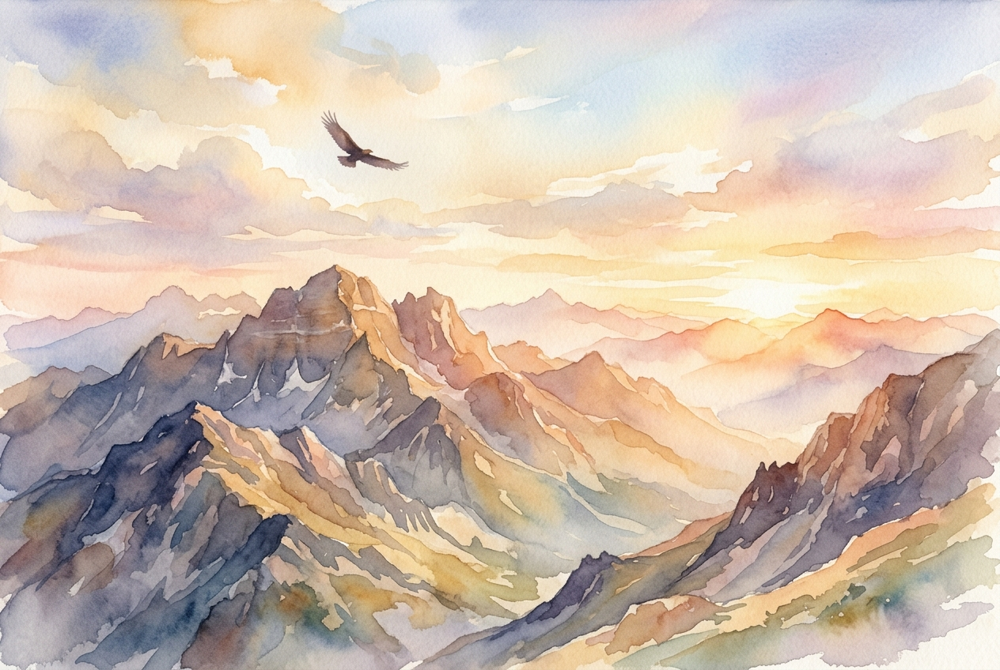

# Daily Reading: Isaiah 40:28-31

*October 11, 2026*

> *(Image: A lone eagle soaring high above a vast, rugged mountain range bathed in the warm, golden light of dawn.)*

## The Reading (NLT)

**Isaiah 40:28-31**

> 28 Have you never heard? Have you never understood? The Lord is the everlasting God, the Creator of all the earth. He never grows weak or weary. No one can measure the depths of his understanding. 29 He gives power to the weak and strength to the powerless. 30 Even youths will become weak and tired, and young men will fall in exhaustion. 31 But those who trust in the Lord will find new strength. They will soar high on wings like eagles. They will run and not grow weary. They will walk and not faint.

## The Story

The prophet addresses a community in exile, a people worn down by decades of displacement and despair. They feel forgotten, wondering if their Maker has lost the ability or the desire to intervene. In response, the text shifts their gaze away from their immediate exhaustion and toward the cosmic scale of the Creator. It draws a stark contrast between human limitation and divine infinite capacity. In the ancient world, vitality was often associated with youth, yet the prophet points out that even the prime of human life is subject to fatigue. True endurance, the passage suggests, does not come from human grit, but from an external, eternal source.

## Application for Today

We live in a culture that praises relentless hustle and self-reliance, pushing us to depend entirely on our own reserves. When we hit the wall of our own limitations, it can feel like a personal failure. Yet this ancient poetry invites us to accept our natural frailty as a given, rather than a flaw. It suggests that our moments of deepest exhaustion are actually invitations to release our grip and lean on a wisdom far deeper than our own. By acknowledging that we cannot sustain ourselves indefinitely, we make room for a different kind of energy. Waiting quietly for divine renewal allows us to rise above our circumstances, finding the steady pace needed to keep moving forward.

---

*Scripture quotations are taken from the Holy Bible, New Living Translation, copyright © 1996, 2004, 2015 by Tyndale House Foundation. Used by permission of Tyndale House Publishers.*
