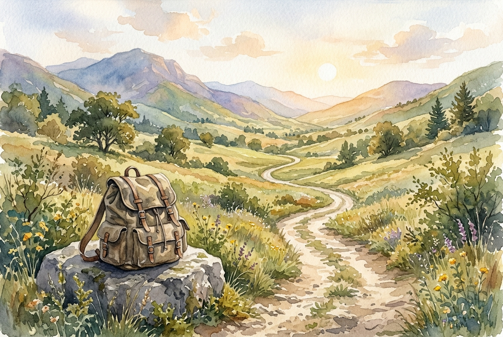

# Daily Reading: Hebrews 12:1-3

*October 12, 2026*

> *(Image: A solitary worn dirt path winding through a peaceful sunlit valley with a discarded heavy canvas pack resting on a stone in the foreground.)*

## The Reading (NLT)

**Hebrews 12:1-3**

> 1 Therefore, since we are surrounded by such a huge crowd of witnesses to the life of faith, let us strip off every weight that slows us down, especially the sin that so easily trips us up. And let us run with endurance the race God has set before us. 2 We do this by keeping our eyes on Jesus, the champion who initiates and perfects our faith. Because of the joy awaiting him, he endured the cross, disregarding its shame. Now he is seated in the place of honor beside God's throne. 3 Think of all the hostility he endured from sinful people; then you won't become weary and give up.

## The Story

The writer of Hebrews imagines the life of faith as an ancient athletic competition held in a vast stadium. The stands are packed with those who have already completed their own grueling events, representing the faithful ancestors mentioned just prior in the letter. To compete in this arena, a runner cannot carry unnecessary baggage or wear restrictive clothing. Every ounce of distraction must be shed to maintain a steady and enduring pace. The ultimate focal point for the athletes is not the cheering crowd, but the one who has already conquered the most agonizing course imaginable by holding on to a future joy.

## Application for Today

We often try to run our spiritual course while carrying armfuls of heavy burdens. These might be persistent habits, old resentments, or simply the exhaustion of trying to manage everything on our own. When the path grows steep and our energy fades, the temptation to quit can feel overwhelming. The encouragement here is to look away from our exhaustion and fix our attention on the one who already finished the hardest path. Remembering his endurance through intense opposition helps us regain our footing and reminds us that we are not running alone.

---

*Scripture quotations are taken from the Holy Bible, New Living Translation, copyright © 1996, 2004, 2015 by Tyndale House Foundation. Used by permission of Tyndale House Publishers.*
