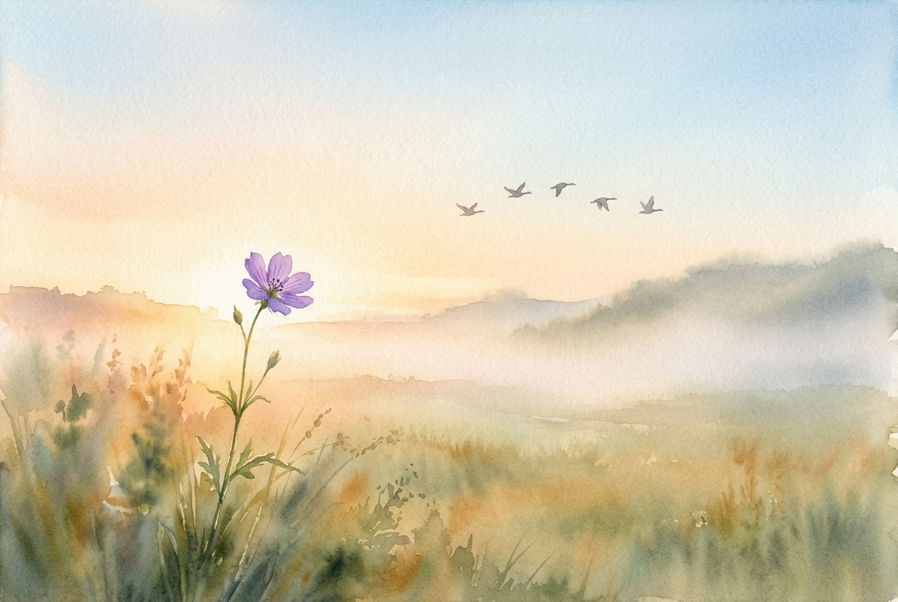

# Daily Reading: Matthew 6:25-34

*October 12, 2026*

> *(Image: A tranquil morning landscape showing a solitary wildflower growing in a sunlit field, with a soft mist in the background and a few birds flying gently across a clear sky.)*

## The Reading (NLT)

**Matthew 6:25-34**

> 25 That is why I tell you not to worry about everyday life whether you have enough food and drink, or enough clothes to wear. Isn't life more than food, and your body more than clothing? 26 Look at the birds. They don't plant or harvest or store food in barns, for your heavenly Father feeds them. And aren't you far more valuable to him than they are? 27 Can all your worries add a single moment to your life? 28 And why worry about your clothing? Look at the lilies of the field and how they grow. They don't work or make their clothing, 29 yet Solomon in all his glory was not dressed as beautifully as they are. 30 And if God cares so wonderfully for wildflowers that are here today and thrown into the fire tomorrow, he will certainly care for you. Why do you have so little faith? 31 So don't worry about these things, saying, ‘What will we eat? What will we drink? What will we wear?' 32 These things dominate the thoughts of unbelievers, but your heavenly Father already knows all your needs. 33 Seek the Kingdom of God above all else, and live righteously, and he will give you everything you need. 34 So don't worry about tomorrow, for tomorrow will bring its own worries. Today's trouble is enough for today.

## The Story

In the ancient world, securing basic necessities was a daily, labor-intensive struggle for most people. Jesus was speaking to an audience of common laborers, farmers, and tradespeople who knew the harsh reality of unpredictable harvests and fragile economies. When he pointed their attention to the local wildlife and wildflowers, he was drawing from the immediate landscape of Galilee. These natural elements were entirely dependent on the rhythms of creation, yet they thrived without the anxious striving that characterized human existence. By contrasting the effortless beauty of a simple flower with the legendary wealth of ancient kings, he challenged their assumptions about security. The invitation was to observe how the Creator sustains the world and to recognize their own immense value within that design.

## Application for Today

We live in an era where anxiety often feels like a responsible way to prepare for the future. We carry the weight of tomorrow before it even arrives, exhausting ourselves by trying to control outcomes we cannot see. The teaching here does not dismiss the reality of our needs or the wisdom of preparation, but it asks us to examine where we place our ultimate trust. When we shift our primary focus toward seeking a righteous and God-centered life, the frantic need to secure our own existence begins to lose its grip. We are invited to lay down the heavy, unproductive burden of worry and live fully in the present moment. Grace is given for the challenges of today, and we can trust that tomorrow will be held by the same faithful hands.

---

*Scripture quotations are taken from the Holy Bible, New Living Translation, copyright © 1996, 2004, 2015 by Tyndale House Foundation. Used by permission of Tyndale House Publishers.*
