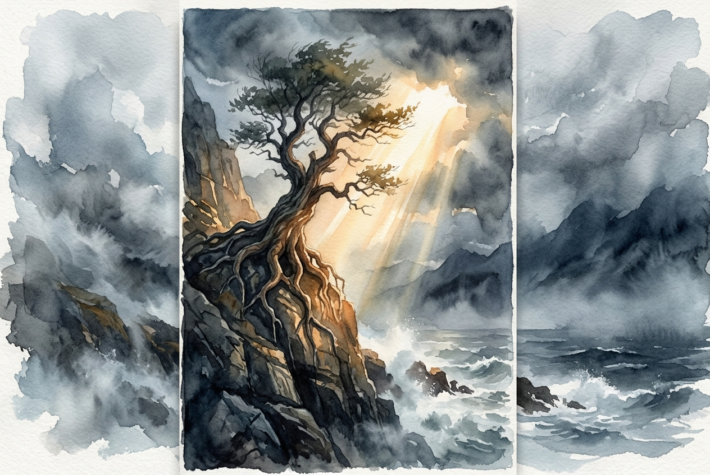

# Daily Reading: Romans 8:31-39

*October 13, 2026*

> *(Image: A massive, ancient tree with deep roots gripping a rocky cliff face, standing resilient against a swirling, misty storm while bathed in a warm, piercing ray of golden sunlight.)*

## The Reading (NLT)

**Romans 8:31-39**

> 31 What shall we say about such wonderful things as these? If God is for us, who can ever be against us? 32 Since he did not spare even his own Son but gave him up for us all, won't he also give us everything else? 33 Who dares accuse us whom God has chosen for his own? No one for God himself has given us right standing with himself. 34 Who then will condemn us? No one for Christ Jesus died for us and was raised to life for us, and he is sitting in the place of honor at God's right hand, pleading for us. 35 Can anything ever separate us from Christ's love? Does it mean he no longer loves us if we have trouble or calamity, or are persecuted, or hungry, or destitute, or in danger, or threatened with death? 36 (As the Scriptures say, For your sake we are killed every day; we are being slaughtered like sheep.) 37 No, despite all these things, overwhelming victory is ours through Christ, who loved us. 38 And I am convinced that nothing can ever separate us from God's love. Neither death nor life, neither angels nor demons, neither our fears for today nor our worries about tomorrow not even the powers of hell can separate us from God's love. 39 No power in the sky above or in the earth below indeed, nothing in all creation will ever be able to separate us from the love of God that is revealed in Christ Jesus our Lord.

## The Story

Paul writes to a community in Rome that understands the reality of imperial power and the constant threat of persecution. In this letter, he builds a meticulous argument about grace, culminating in a soaring declaration of ultimate security. He lists the very real dangers these early believers face, from physical starvation to state violence. Then, he expands his scope to cosmic forces, naming life, death, and unseen spiritual realms. His point is not that these threats are imaginary, but that they are entirely powerless against the divine commitment made to humanity. He anchors their security not in their own endurance, but in the definitive action of the Creator.

## Application for Today

We often measure our spiritual standing by our current circumstances, assuming that hardship implies divine abandonment. When crisis hits, the quiet fear that we are on our own can easily take root. This passage invites us to radically shift our perspective on what secures our lives. The promise here is not an exemption from pain, anxiety, or the chaotic forces of the world. Rather, it is the profound assurance that absolutely nothing in the fabric of reality has the authority to sever our connection to divine love. We can face the uncertainties of today and the fears of tomorrow knowing we are securely held.

---

*Scripture quotations are taken from the Holy Bible, New Living Translation, copyright © 1996, 2004, 2015 by Tyndale House Foundation. Used by permission of Tyndale House Publishers.*
