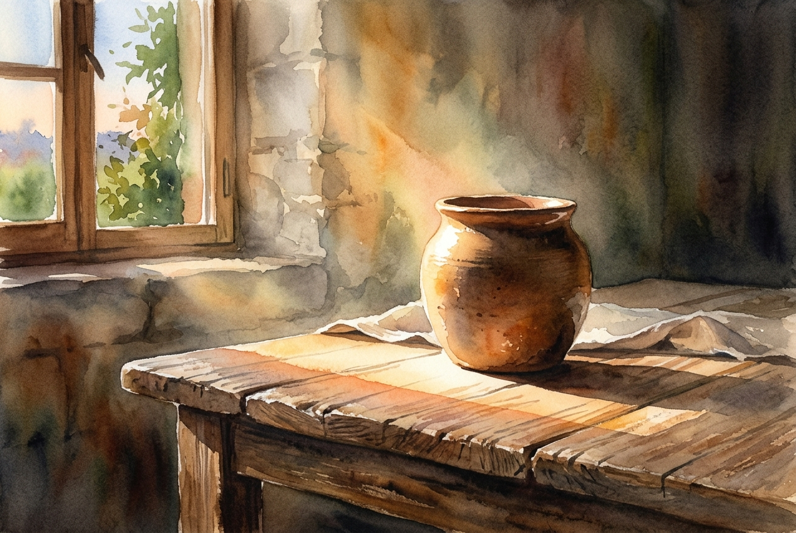

# Leitura Diária: Romans 12:1-2

*14 de outubro de 2026*

> *(Image: A solitary clay vessel resting on a rustic wooden table illuminated by a warm shaft of morning light streaming through an unseen window, symbolizing an ordinary life set apart.)*

## A Leitura (PT-NVI)

**Romans 12:1-2**

> 1 Portanto, irmãos, rogo-lhes pelas misericórdias de Deus que se ofereçam em sacrifício vivo, santo e agradável a Deus; este é o culto racional de vocês. 2 Não se amoldem ao padrão deste mundo, mas transformem-se pela renovação da sua mente, para que sejam capazes de experimentar e comprovar a boa, agradável e perfeita vontade de Deus.

## A História

A carta de Paulo aos primeiros cristãos em Roma chega a um ponto de virada neste trecho, passando de reflexões teológicas profundas para a prática diária da fé. No mundo antigo, a adoração era quase sempre associada ao sacrifício de um animal em um altar físico. O autor subverte completamente essa expectativa cultural, propondo que a própria vida contínua e pulsante do cristão é a verdadeira oferta. Isso redefine o dever sagrado, que deixa de ser um ritual em um templo para se tornar a dedicação constante das ações comuns. A cultura do império romano exercia uma pressão imensa sobre como as pessoas deveriam viver e pensar. Resistir a esse molde exigia uma reconfiguração profunda da perspectiva interior de cada um.

## Aplicação para Hoje

Somos constantemente moldados pela sociedade ao nosso redor, seja pela mídia que consumimos, pelo ritmo frenético do trabalho ou pelos valores que nos cercam. É muito fácil absorver essas pressões externas sem sequer percebermos que estamos nos adaptando a elas. O convite deste texto é fazer uma pausa e permitir que a graça divina interrompa nosso modo automático de viver. Quando abrimos intencionalmente nossa mente para uma nova forma de enxergar o mundo, nossos hábitos diários começam a mudar. Descobrimos que a verdadeira devoção não se limita a um encontro semanal, mas se manifesta na maneira como tratamos os outros e lidamos com nossas lutas. À medida que nossa visão é renovada, tornamo-nos mais capazes de reconhecer os caminhos bons e cheios de vida que nos são propostos.

---

*Citações bíblicas extraídas da Nova Versão Internacional (NVI), © 1993, 2000 por Biblica, Inc. Usado com permissão.*
