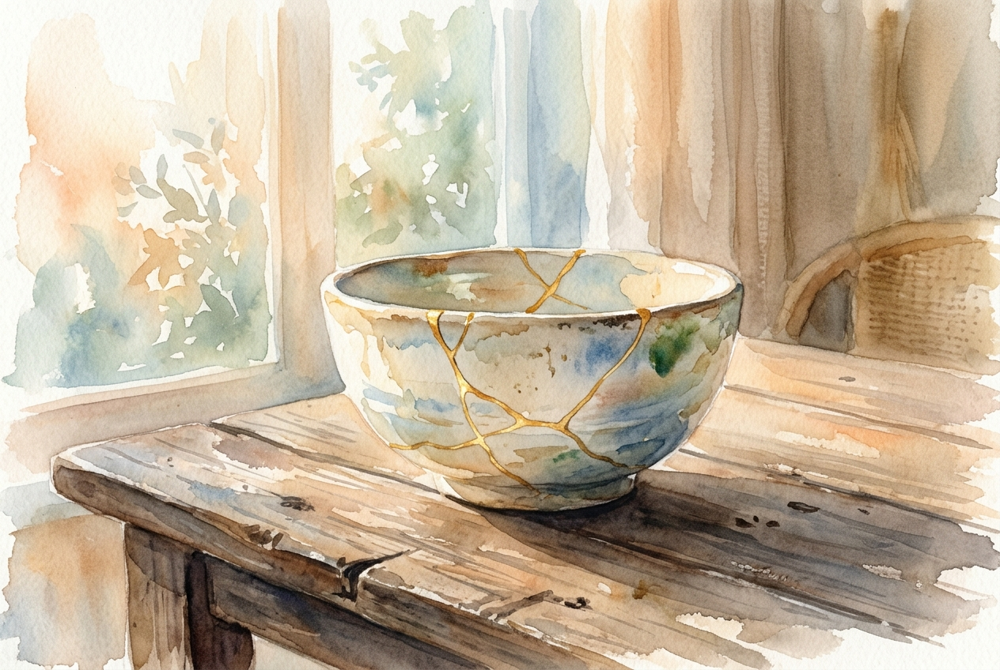

# Daily Reading: Ephesians 2:1-10

*October 14, 2026*

> *(Image: A beautifully crafted ceramic bowl with delicate gold kintsugi repairs resting on a rustic wooden table bathed in warm morning sunlight.)*

## The Reading (NLT)

**Ephesians 2:1-10**

> 1 Once you were dead because of your disobedience and your many sins. 2 You used to live in sin, just like the rest of the world, obeying the devil the commander of the powers in the unseen world. He is the spirit at work in the hearts of those who refuse to obey God. 3 All of us used to live that way, following the passionate desires and inclinations of our sinful nature. By our very nature we were subject to God's anger, just like everyone else. 4 But God is so rich in mercy, and he loved us so much, 5 that even though we were dead because of our sins, he gave us life when he raised Christ from the dead. (It is only by God's grace that you have been saved!) 6 For he raised us from the dead along with Christ and seated us with him in the heavenly realms because we are united with Christ Jesus. 7 So God can point to us in all future ages as examples of the incredible wealth of his grace and kindness toward us, as shown in all he has done for us who are united with Christ Jesus. 8 God saved you by his grace when you believed. And you can't take credit for this; it is a gift from God. 9 Salvation is not a reward for the good things we have done, so none of us can boast about it. 10 For we are God's masterpiece. He has created us anew in Christ Jesus, so we can do the good things he planned for us long ago.

## The Story

The author of this letter paints a stark contrast between a community's past and its present. In the ancient Mediterranean, people often felt trapped by fate, unseen spiritual forces, or their own destructive habits. The letter describes this former way of life as a kind of spiritual lifelessness, where humanity is caught in a cycle of rebellion and self-interest. But the narrative pivots dramatically on the character of God, who intervenes out of sheer mercy. The text shifts the focus entirely away from human effort, emphasizing that rescue comes as a pure gift rather than a reward for good behavior. It concludes with a beautiful image: believers are described as divine poetry or craftsmanship, reshaped for a specific purpose.

## Application for Today

We often measure our worth by our productivity, our moral track record, or how well we keep our lives together. This passage dismantles that exhausting system of scorekeeping. You do not have to earn your place or prove your value before receiving divine love. Instead, your life is a gift freely given, restoring you when you feel emotionally or spiritually depleted. But this gift is not meant to be kept on a shelf. You are being remade to participate in the restoration of the world around you. The kindness you show, the justice you seek, and the love you offer are the very things you were designed to do all along.

---

*Scripture quotations are taken from the Holy Bible, New Living Translation, copyright © 1996, 2004, 2015 by Tyndale House Foundation. Used by permission of Tyndale House Publishers.*
