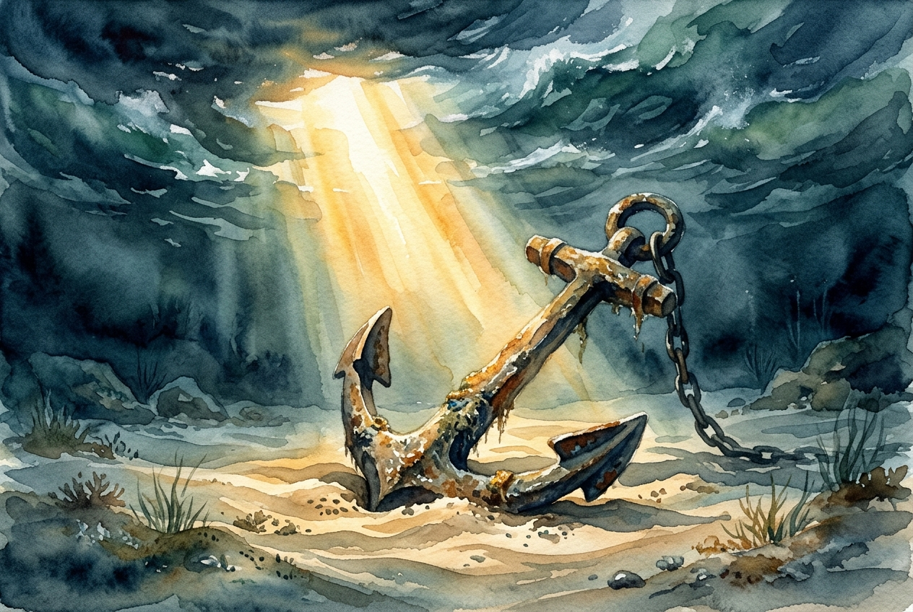

# Daily Reading: James 1:2-8

*October 15, 2026*

> *(Image: A heavy weathered iron anchor rests securely on a peaceful sandy seabed beneath turbulent ocean waves, illuminated by a single piercing ray of golden sunlight.)*

## The Reading (NLT)

**James 1:2-8**

> 2 Dear brothers and sisters, when troubles of any kind come your way, consider it an opportunity for great joy. 3 For you know that when your faith is tested, your endurance has a chance to grow. 4 So let it grow, for when your endurance is fully developed, you will be perfect and complete, needing nothing. 5 If you need wisdom, ask our generous God, and he will give it to you. He will not rebuke you for asking. 6 But when you ask him, be sure that your faith is in God alone. Do not waver, for a person with divided loyalty is as unsettled as a wave of the sea that is blown and tossed by the wind. 7 Such people should not expect to receive anything from the Lord. 8 Their loyalty is divided between God and the world, and they are unstable in everything they do.

## The Story

The letter of James was written to a scattered community of early believers facing intense social and economic pressure. Instead of offering them a strategy to escape their hardship, the author presents a radical reframing of their suffering. He suggests that the fires of difficulty are actually the very environment where spiritual maturity is forged. The goal is not just surviving the ordeal, but allowing the pressure to produce a deep, unshakeable endurance. When the community lacks the clarity to see this bigger picture, they are invited to ask their Creator for wisdom. God is described here not as a reluctant benefactor, but as a generous giver who welcomes their requests without criticism. The only requirement is a unified heart, trusting in that generosity rather than being tossed about by competing allegiances.

## Application for Today

Hardship has a way of fracturing our focus, leaving us feeling like a small boat caught in unpredictable currents. When we face trials, our instinct is often to scramble for immediate relief or to hedge our bets by trusting in our own cleverness alongside our faith. Yet, true stability comes from a singular reliance on the character of God. We are invited to bring our confusion directly to the source of wisdom, trusting that we will be met with open hands rather than a lecture. By letting our difficulties teach us endurance, we slowly become people of profound integrity and wholeness. This inner steadiness allows us to remain present and grounded, even when the winds around us are howling. Ultimately, our trials become the unexpected soil where our deepest growth takes root.

---

*Scripture quotations are taken from the Holy Bible, New Living Translation, copyright © 1996, 2004, 2015 by Tyndale House Foundation. Used by permission of Tyndale House Publishers.*
