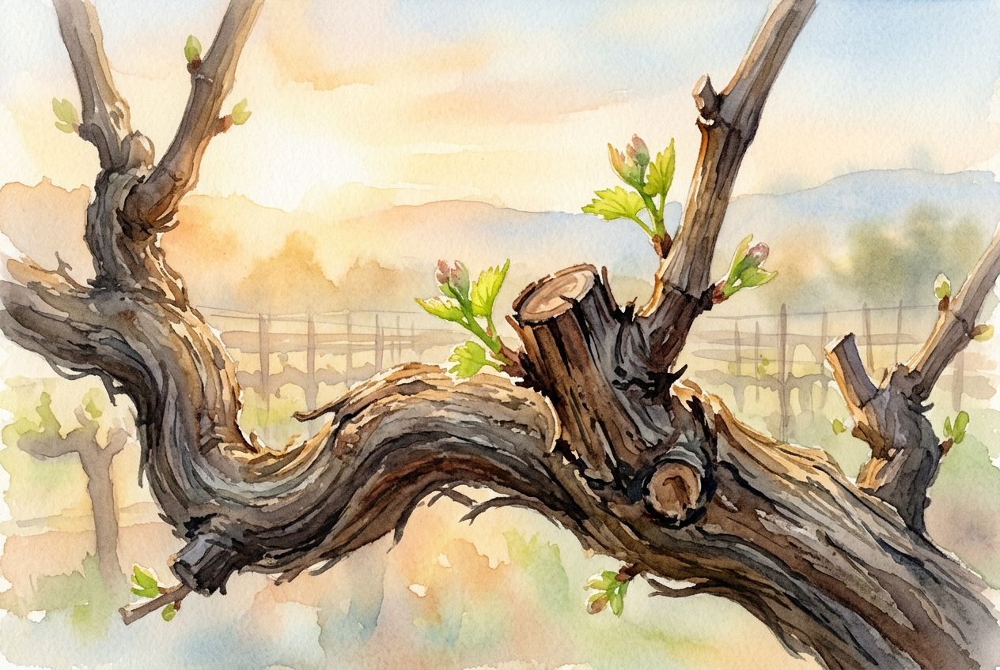

# Daily Reading: John 15:1-11

*October 18, 2026*

> *(Image: A close-up view of a weathered grapevine in the warm light of early morning, with careful pruning cuts visible on the wood and fresh green shoots beginning to emerge.)*

## The Reading (NLT)

**John 15:1-11**

> 1 I am the true grapevine, and my Father is the gardener. 2 He cuts off every branch of mine that doesn't produce fruit, and he prunes the branches that do bear fruit so they will produce even more. 3 You have already been pruned and purified by the message I have given you. 4 Remain in me, and I will remain in you. For a branch cannot produce fruit if it is severed from the vine, and you cannot be fruitful unless you remain in me. 5 Yes, I am the vine; you are the branches. Those who remain in me, and I in them, will produce much fruit. For apart from me you can do nothing. 6 Anyone who does not remain in me is thrown away like a useless branch and withers. Such branches are gathered into a pile to be burned. 7 But if you remain in me and my words remain in you, you may ask for anything you want, and it will be granted! 8 When you produce much fruit, you are my true disciples. This brings great glory to my Father. 9 I have loved you even as the Father has loved me. Remain in my love. 10 When you obey my commandments, you remain in my love, just as I obey my Father's commandments and remain in his love. 11 I have told you these things so that you will be filled with my joy. Yes, your joy will overflow!

## The Story

In the ancient Mediterranean world, vineyards were a common sight and a vital part of the local economy. Jesus uses this familiar imagery during his final meal with his followers to explain the deep, organic connection he shares with them. The metaphor of a vine and its branches illustrates a relationship not based on rigid duty, but on a shared life source. A careful viticulturist knows that wild, unchecked growth often leads to a weak harvest. Therefore, cutting back healthy branches is a standard practice to direct the plant's energy toward producing the best possible yield. This everyday agricultural reality serves as a powerful symbol for the realities of spiritual maturity.

## Application for Today

We often view any form of loss or reduction in our lives as a failure, yet this passage invites a profound shift in perspective. Spiritual growth sometimes requires a painful season of cutting back, where distractions, unhealthy habits, or even good things are removed to make room for what is essential. True vitality comes from simply staying connected to the source of love rather than striving for independent success. When we feel stripped bare, we might actually be experiencing the careful attention of a loving gardener preparing us for a richer season. By resting in that connection, our daily choices become a natural response rather than a heavy burden. Ultimately, this deep-rooted life leads to an enduring overflow of joy that difficult circumstances cannot easily shake.

---

*Scripture quotations are taken from the Holy Bible, New Living Translation, copyright © 1996, 2004, 2015 by Tyndale House Foundation. Used by permission of Tyndale House Publishers.*
