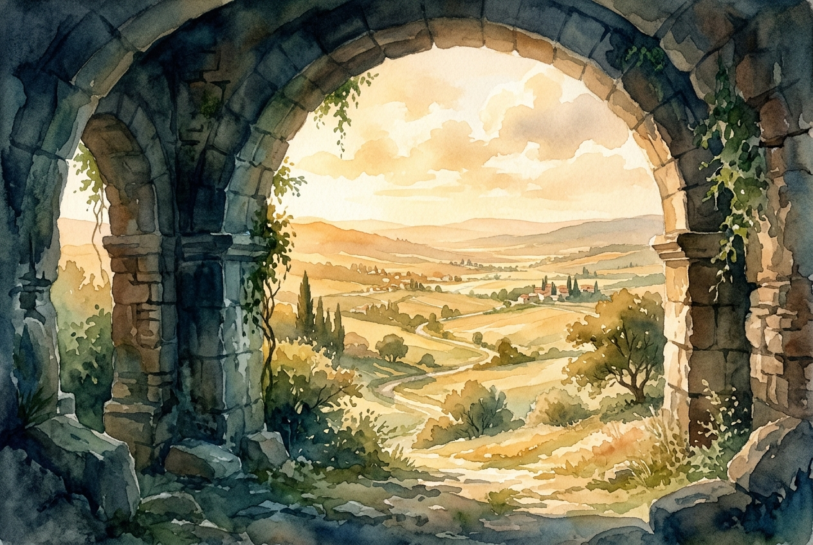

# Leitura Diária: Psalm 91

*18 de outubro de 2026*

> *(Image: A massive, ancient stone archway provides deep, cooling shade in the foreground, while soft, golden sunlight illuminates a vast, peaceful valley beyond.)*

## A Leitura (PT-NVI)

**Psalm 91**

> 1 Aquele que habita no abrigo do Altíssimo e descansa à sombra do Todo-poderoso 2 pode dizer ao Senhor: Tu és o meu refúgio e a minha fortaleza, o meu Deus, em quem confio. 3 Ele o livrará do laço do caçador e do veneno mortal. 4 Ele o cobrirá com as suas penas, e sob as suas asas você encontrará refúgio; a fidelidade dele será o seu escudo protetor. 5 Você não temerá o pavor da noite, nem a flecha que voa de dia, 6 nem a peste que se move sorrateira nas trevas, nem a praga que devasta ao meio-dia. 7 Mil poderão cair ao seu lado, dez mil à sua direita, mas nada o atingirá. 8 Você simplesmente olhará, e verá o castigo dos ímpios. 9 Se você fizer do Altíssimo o seu refúgio, 10 nenhum mal o atingirá, desgraça alguma chegará à sua tenda. 11 Porque a seus anjos ele dará ordens a seu respeito, para que o protejam em todos os seus caminhos; 12 com as mãos eles o segurarão, para que você não tropece em alguma pedra. 13 Você pisará o leão e a cobra; pisoteará o leão forte e a serpente. 14 "Porque ele me ama, eu o resgatarei; eu o protegerei, pois conhece o meu nome. 15 Ele clamará a mim, e eu lhe darei resposta, e na adversidade estarei com ele; vou livrá-lo e cobri-lo de honra. 16 Vida longa eu lhe darei, e lhe mostrarei a minha salvação. "

## A História

Os antigos israelitas compreendiam perfeitamente a vulnerabilidade de viver em um ambiente hostil e imprevisível. Em um mundo sem medicina moderna ou fronteiras seguras, as ameaças de doenças, predadores e violência repentina eram realidades constantes. Este salmo utiliza uma rica linguagem poética para descrever Deus não como um governante distante, mas como um santuário físico e imediato. O autor imagina um pássaro abrigando seus filhotes e uma fortaleza imponente oferecendo asilo aos cansados. O foco central está na escolha ativa de habitar e permanecer nessa proximidade. É um cântico para aqueles que decidiram fazer da presença divina o seu endereço permanente, em vez de apenas um abrigo temporário durante uma tempestade.

## Aplicação para Hoje

Encontrar nossa segurança em Deus não significa que recebemos imunidade contra as dores comuns da vida humana. A promessa aqui diz respeito a uma segurança definitiva e à paz profunda que nasce de um relacionamento contínuo e vivo com o nosso Criador. Quando escolhemos habitar esse espaço de confiança, nossa perspectiva sobre os perigos do mundo começa a mudar. Ainda enfrentamos as flechas e a escuridão, mas lidamos com elas a partir de um lugar de conexão profunda e enraizada. O verdadeiro refúgio não se encontra na ausência de problemas, mas na presença constante daquele que nos sustenta. Ao permanecermos perto, descobrimos uma resiliência silenciosa que supera qualquer medo passageiro.

---

*Citações bíblicas extraídas da Nova Versão Internacional (NVI), © 1993, 2000 por Biblica, Inc. Usado com permissão.*
