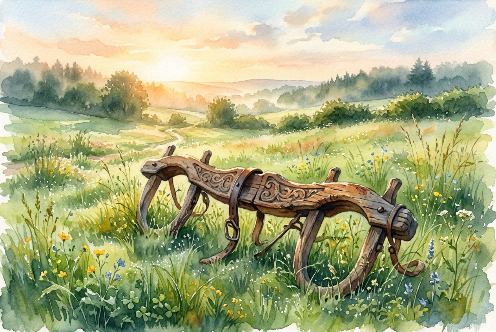

# Daily Reading: Matthew 11:28-30

*October 19, 2026*

> *(Image: A beautifully carved, antique wooden agricultural yoke resting peacefully in a lush green meadow bathed in the warm, golden light of early morning.)*

## The Reading (NLT)

**Matthew 11:28-30**

> 28 Then Jesus said, Come to me, all of you who are weary and carry heavy burdens, and I will give you rest. 29 Take my yoke upon you. Let me teach you, because I am humble and gentle at heart, and you will find rest for your souls. 30 For my yoke is easy to bear, and the burden I give you is light.

## The Story

In first-century agrarian communities, wooden harnesses were custom-carved to fit the shoulders of oxen, allowing them to pull heavy plows together. Religious teachers of the era often used this imagery, speaking of the law as a harness one must wear to serve God. For many everyday people, this spiritual framework had become an exhausting, crushing weight of endless rules and impossible standards. Rather than offering freedom, the religious elite piled on demands that left the vulnerable feeling entirely depleted. The invitation here completely upends that dynamic, offering an alternative way of living that does not crush the spirit. The teacher presents a new way forward, one defined by humility rather than rigid enforcement.

## Application for Today

We often walk through life carrying loads we were never designed to bear. Whether it is the pressure to prove our worth, the anxiety of performing perfectly, or the exhaustion of trying to manage everything on our own, our modern burdens leave us deeply depleted. The call here is not to stop working or abandon our responsibilities entirely, but to change how we carry them and who we carry them with. Stepping into this new rhythm means trading our self-made pressures for the gentle guidance of a teacher who understands our limits. When we align our pace with a humble guide, the crushing weight of our daily striving begins to lift. We discover that true spiritual relief is found not in doing nothing, but in walking alongside one who shares the load.

---

*Scripture quotations are taken from the Holy Bible, New Living Translation, copyright © 1996, 2004, 2015 by Tyndale House Foundation. Used by permission of Tyndale House Publishers.*
