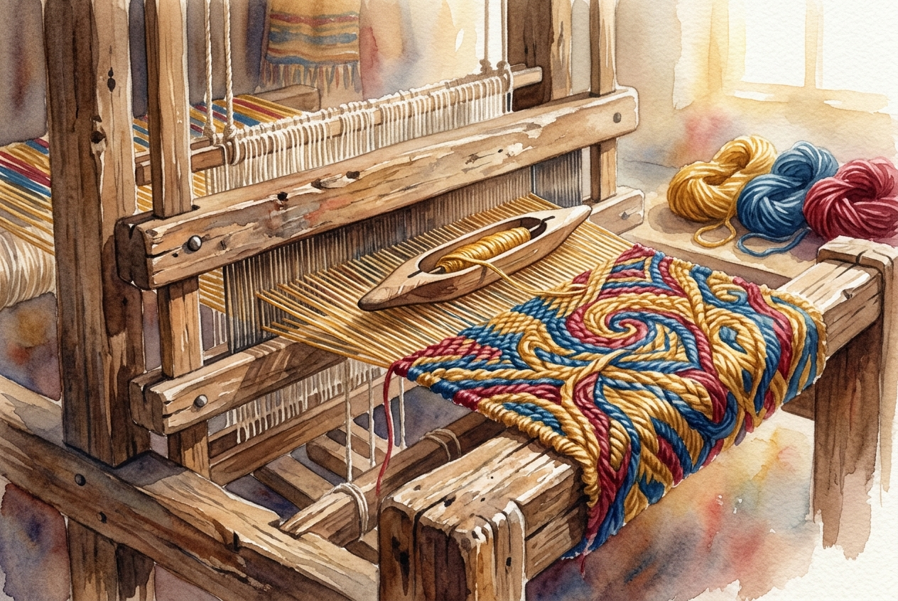

# Daily Reading: Colossians 3:12-17

*October 19, 2026*

> *(Image: A close-up of a rustic wooden loom weaving threads of gold, blue, and crimson into a strong, unified tapestry under soft morning light.)*

## The Reading (NLT)

**Colossians 3:12-17**

> 12 Since God chose you to be the holy people he loves, you must clothe yourselves with tenderhearted mercy, kindness, humility, gentleness, and patience. 13 Make allowance for each other's faults, and forgive anyone who offends you. Remember, the Lord forgave you, so you must forgive others. 14 Above all, clothe yourselves with love, which binds us all together in perfect harmony. 15 And let the peace that comes from Christ rule in your hearts. For as members of one body you are called to live in peace. And always be thankful. 16 Let the message about Christ, in all its richness, fill your lives. Teach and counsel each other with all the wisdom he gives. Sing psalms and hymns and spiritual songs to God with thankful hearts. 17 And whatever you do or say, do it as a representative of the Lord Jesus, giving thanks through him to God the Father.

## The Story

In the ancient Mediterranean world, clothing was a primary marker of identity, status, and allegiance. When the author of this letter tells the early believers to adopt a new way of presenting themselves, he uses a powerful cultural image of transformation. These early communities were a messy mix of different social classes, backgrounds, and traditions trying to figure out how to exist together. The virtues highlighted here are not just private attitudes, but deeply relational practices meant to govern how they treat each other. By framing these qualities as daily garments, the text suggests that grace and patience are intentional choices. Love is described as the final piece that holds the entire structure together, keeping the community from unraveling.

## Application for Today

It is easy to view spiritual growth as an isolated, individual project. Yet this passage reminds us that our faith is lived out in the friction of human relationships. We are invited to bring the same gentleness and forgiveness we have received into our interactions with those who test our patience. When the peace of Christ acts as the guiding force in our hearts, it changes the atmosphere of our homes and workplaces. We learn to make space for the flaws of others, recognizing that we are all works in progress. Living as representatives of that peace is a daily practice of choosing compassion over conflict. Ultimately, our shared gratitude becomes the song that sustains us through the heavy lifting of life.

---

*Scripture quotations are taken from the Holy Bible, New Living Translation, copyright © 1996, 2004, 2015 by Tyndale House Foundation. Used by permission of Tyndale House Publishers.*
