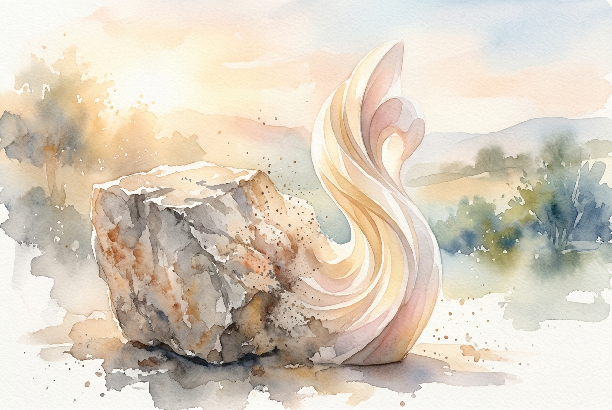

# Leitura Diária: Ephesians 2:1-10

*20 de outubro de 2026*

> *(Image: A dusty block of rough stone slowly giving way to a beautifully carved, luminous sculpture bathed in soft morning light.)*

## A Leitura (PT-NVI)

**Ephesians 2:1-10**

> 1 Vocês estavam mortos em suas transgressões e pecados, 2 nos quais costumavam viver, quando seguiam a presente ordem deste mundo e o príncipe do poder do ar, o espírito que agora está atuando nos que vivem na desobediência. 3 Anteriormente, todos nós também vivíamos entre eles, satisfazendo as vontades da nossa carne, seguindo os seus desejos e pensamentos. Como os outros, éramos por natureza merecedores da ira. 4 Todavia, Deus, que é rico em misericórdia, pelo grande amor com que nos amou, 5 deu-nos vida juntamente com Cristo, quando ainda estávamos mortos em transgressões — pela graça vocês são salvos. 6 Deus nos ressuscitou com Cristo e com ele nos fez assentar nos lugares celestiais em Cristo Jesus, 7 para mostrar, nas eras que hão de vir, a incomparável riqueza de sua graça, demonstrada em sua bondade para conosco em Cristo Jesus. 8 Pois vocês são salvos pela graça, por meio da fé, e isto não vem de vocês, é dom de Deus; 9 não por obras, para que ninguém se glorie. 10 Porque somos criação de Deus realizada em Cristo Jesus para fazermos boas obras, as quais Deus preparou de antemão para que nós as praticássemos.

## A História

A carta aos efésios é direcionada a pessoas que viviam em um enorme centro cultural e econômico, cercadas por monumentos às conquistas humanas e à glória imperial. Naquela sociedade, o valor de alguém estava inteiramente atrelado ao seu status, à sua linhagem e ao que a pessoa podia produzir ou conquistar. O autor inverte essa lógica exaustiva ao contrastar os caminhos vazios do mundo com uma economia espiritual totalmente diferente. Ele descreve os primeiros cristãos não como engrenagens de uma máquina social, mas como pessoas que foram resgatadas de um estado de letargia espiritual para uma existência vibrante. Essa transformação não tem absolutamente nada a ver com esforço próprio ou ascensão social. Ao contrário, o resgate deles é apresentado como um presente puro e imerecido de um Criador profundamente misericordioso. Eles são redefinidos não pelo que alcançam, mas por quem os formou.

## Aplicação para Hoje

Ainda vivemos em um mundo que exige constantemente que provemos nosso valor por meio de nossas realizações, currículos e produtividade. É incrivelmente fácil internalizar a ideia de que precisamos fazer por merecer o nosso espaço, até mesmo em nosso relacionamento com o Divino. No entanto, este texto desconstrói a necessidade exaustiva de justificar a nossa própria existência. Somos convidados a descer da esteira do desempenho e simplesmente aceitar que somos profundamente amados sem precisarmos trabalhar por isso. É apenas a partir desse lugar de profundo descanso que podemos começar a viver o nosso verdadeiro propósito. O bem que fazemos no mundo deixa de ser uma tentativa desesperada de ganhar aprovação para se tornar uma resposta natural e alegre à graça que já recebemos. Somos convidados a nos enxergar como uma obra de arte cuidadosamente esculpida, criada para levar luz aos espaços que habitamos.

---

*Citações bíblicas extraídas da Nova Versão Internacional (NVI), © 1993, 2000 por Biblica, Inc. Usado com permissão.*
