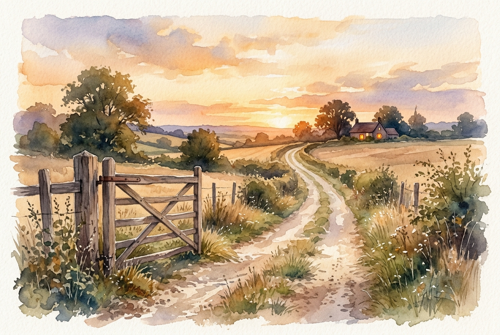

# Leitura Diária: Luke 15:11-32

*22 de outubro de 2026*

> *(Image: A long, dusty country road stretching toward the horizon at golden hour, with an open rustic wooden gate in the foreground and a warm, inviting light glowing from a distant home.)*

## A Leitura (PT-NVI)

**Luke 15:11-32**

> 11 Jesus continuou: "Um homem tinha dois filhos. 12 O mais novo disse ao seu pai: ‘Pai, quero a minha parte da herança’. Assim, ele repartiu sua propriedade entre eles. 13 "Não muito tempo depois, o filho mais novo reuniu tudo o que tinha, e foi para uma região distante; e lá desperdiçou os seus bens vivendo irresponsavelmente. 14 Depois de ter gasto tudo, houve uma grande fome em toda aquela região, e ele começou a passar necessidade. 15 Por isso foi empregar-se com um dos cidadãos daquela região, que o mandou para o seu campo a fim de cuidar de porcos. 16 Ele desejava encher o estômago com as vagens de alfarrobeira que os porcos comiam, mas ninguém lhe dava nada. 17 "Caindo em si, ele disse: ‘Quantos empregados de meu pai têm comida de sobra, e eu aqui, morrendo de fome! 18 Eu me porei a caminho e voltarei para meu pai, e lhe direi: Pai, pequei contra o céu e contra ti. 19 Não sou mais digno de ser chamado teu filho; trata-me como um dos teus empregados’. 20 A seguir, levantou-se e foi para seu pai. "Estando ainda longe, seu pai o viu e, cheio de compaixão, correu para seu filho, e o abraçou e beijou. 21 "O filho lhe disse: ‘Pai, pequei contra o céu e contra ti. Não sou mais digno de ser chamado teu filho’. 22 "Mas o pai disse aos seus servos: ‘Depressa! Tragam a melhor roupa e vistam nele. Coloquem um anel em seu dedo e calçados em seus pés. 23 Tragam o novilho gordo e matem-no. Vamos fazer uma festa e comemorar. 24 Pois este meu filho estava morto e voltou à vida; estava perdido e foi achado’. E começaram a festejar. 25 "Enquanto isso, o filho mais velho estava no campo. Quando se aproximou da casa, ouviu a música e a dança. 26 Então chamou um dos servos e perguntou-lhe o que estava acontecendo. 27 Este lhe respondeu: ‘Seu irmão voltou, e seu pai matou o novilho gordo, porque o recebeu de volta são e salvo’. 28 "O filho mais velho encheu-se de ira, e não quis entrar. Então seu pai saiu e insistiu com ele. 29 Mas ele respondeu ao seu pai: ‘Olha! todos esses anos tenho trabalhado como um escravo ao teu serviço e nunca desobedeci às tuas ordens. Mas tu nunca me deste nem um cabrito para eu festejar com os meus amigos. 30 Mas quando volta para casa esse seu filho, que esbanjou os teus bens com as prostitutas, matas o novilho gordo para ele! ’ 31 "Disse o pai: ‘Meu filho, você está sempre comigo, e tudo o que tenho é seu. 32 Mas nós tínhamos que comemorar e alegrar-nos, porque este seu irmão estava morto e voltou à vida, estava perdido e foi achado’ ".

## A História

Na cultura do antigo Oriente Médio, exigir a herança antecipada era uma ofensa profunda, quase como desejar o fim do patriarca. Quando o filho mais novo decide voltar, ele espera apenas sobreviver como um trabalhador braçal, antecipando a rejeição de toda a comunidade. No entanto, o pai quebra todos os protocolos da época ao correr ao encontro do rapaz. Esse gesto público e indigno para um homem de sua posição protege o jovem da vergonha perante a aldeia e o restaura imediatamente à família. Em contraste, a reação do filho mais velho revela um outro tipo de distanciamento. Embora nunca tivesse saído da propriedade, seu coração tratava a relação familiar como um contrato de trabalho, incapaz de compreender a gratuidade do amor paterno.

## Aplicação para Hoje

É comum nos identificarmos com um dos dois irmãos ao longo da vida. Às vezes, somos aquele que foge, destruindo tudo pelo caminho e acreditando que precisamos consertar nossos próprios erros antes de sermos aceitos por Deus novamente. Em outros momentos, somos o irmão que fica, cumprindo todas as regras, mas nutrindo um ressentimento silencioso contra aqueles que recebem misericórdia sem merecer. Jesus usa essa narrativa para desconstruir ambas as mentalidades. Deus não é um patrão exigindo um currículo impecável, nem um contador registrando nossas falhas. Ele é o pai que vigia o horizonte, disposto a abandonar qualquer formalidade para nos alcançar, convidando tanto o rebelde quanto o moralista para a festa da sua graça.

---

*Citações bíblicas extraídas da Nova Versão Internacional (NVI), © 1993, 2000 por Biblica, Inc. Usado com permissão.*
