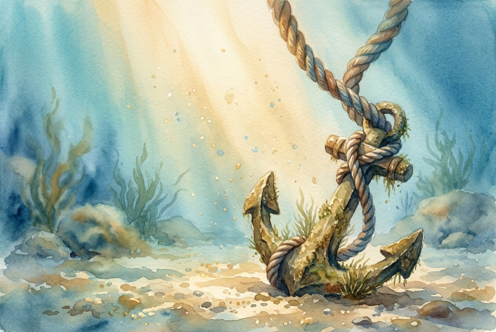

# Leitura Diária: Romans 8:31-39

*23 de outubro de 2026*

> *(Image: A thick ship's mooring rope securely tied to an ancient, weathered stone anchor resting on a peaceful ocean floor, illuminated by a gentle shaft of sunlight from above.)*

## A Leitura (PT-NVI)

**Romans 8:31-39**

> 31 Que diremos, pois, diante dessas coisas? Se Deus é por nós, quem será contra nós? 32 Aquele que não poupou a seu próprio Filho, mas o entregou por todos nós, como não nos dará juntamente com ele, e de graça, todas as coisas? 33 Quem fará alguma acusação contra os escolhidos de Deus? É Deus quem os justifica. 34 Quem os condenará? Foi Cristo Jesus que morreu; e mais, que ressuscitou e está à direita de Deus, e também intercede por nós. 35 Quem nos separará do amor de Cristo? Será tribulação, ou angústia, ou perseguição, ou fome, ou nudez, ou perigo, ou espada? 36 Como está escrito: "Por amor de ti enfrentamos a morte todos os dias; somos considerados como ovelhas destinadas ao matadouro". 37 Mas, em todas estas coisas somos mais que vencedores, por meio daquele que nos amou. 38 Pois estou convencido de que nem morte nem vida, nem anjos nem demônios, nem o presente nem o futuro, nem quaisquer poderes, 39 nem altura nem profundidade, nem qualquer outra coisa na criação será capaz de nos separar do amor de Deus que está em Cristo Jesus, nosso Senhor.

## A História

Paulo escreveu para uma comunidade que vivia à sombra de um império que exigia lealdade absoluta. Os primeiros cristãos romanos enfrentavam imensa pressão social, perigo físico e a constante ameaça de violência. Em sua carta, ele aborda as maiores vulnerabilidades daquela igreja, reconhecendo as realidades brutais da fome, da miséria e da perseguição. Ele usa a linguagem de um tribunal, onde acusações poderiam ser levantadas contra eles, apenas para serem rejeitadas pelo juiz supremo. No entanto, seu argumento muda da defesa legal para uma garantia cósmica. Ele examina todo o universo, desde o reino espiritual invisível até o mundo físico, concluindo que não existe força capaz de cortar a conexão deles com o divino.

## Aplicação para Hoje

Muitas vezes olhamos para nossas próprias dificuldades e nos perguntamos se de alguma forma fomos abandonados. Quando o luto, a ansiedade ou as lutas materiais nos sobrecarregam, é fácil nos sentirmos isolados de qualquer fonte de graça. Este texto nos convida a mudar radicalmente nossa perspectiva sobre o sofrimento. As dificuldades não são um sinal de distância divina, nem nossas falhas dão a alguém o direito de nos condenar. Em vez disso, somos sustentados por um amor que já superou os maiores abismos possíveis. O que quer que você esteja enfrentando hoje, seja um medo interno silencioso ou uma luta muito pública, você está firmemente ancorado. Nada que você encontre pelo caminho pode desatar o nó que o segura.

---

*Citações bíblicas extraídas da Nova Versão Internacional (NVI), © 1993, 2000 por Biblica, Inc. Usado com permissão.*
