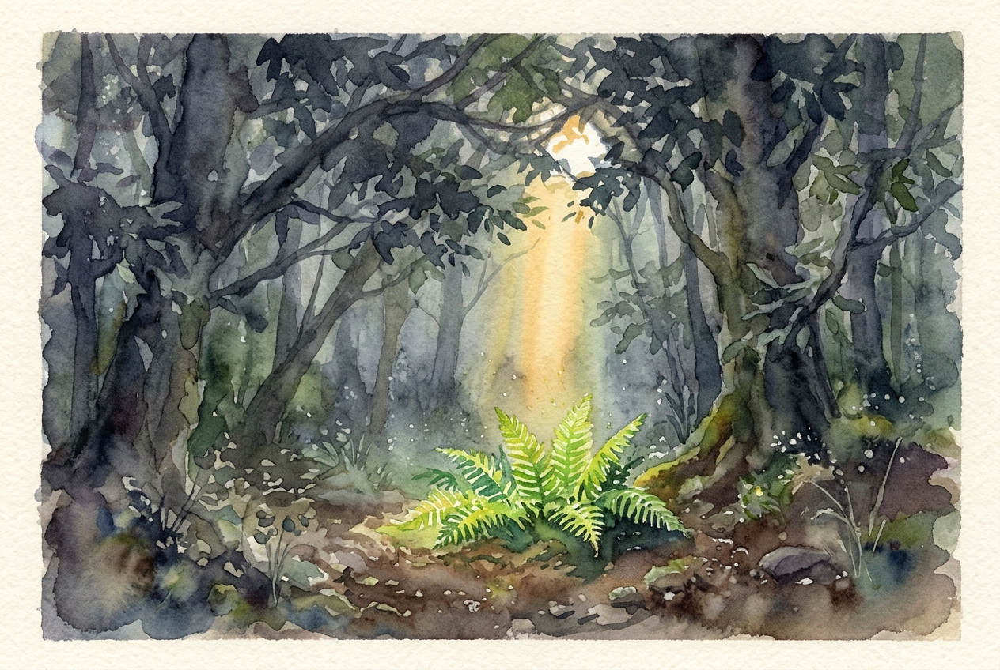

# Leitura Diária: John 3:16-21

*23 de outubro de 2026*

> *(Image: A single beam of warm morning sunlight breaking through a dense canopy of dark forest trees, illuminating a small patch of vibrant green ferns.)*

## A Leitura (PT-NVI)

**John 3:16-21**

> 16 "Porque Deus tanto amou o mundo que deu o seu Filho Unigênito, para que todo o que nele crer não pereça, mas tenha a vida eterna. 17 Pois Deus enviou o seu Filho ao mundo, não para condenar o mundo, mas para que este fosse salvo por meio dele. 18 Quem nele crê não é condenado, mas quem não crê já está condenado, por não crer no nome do Filho Unigênito de Deus. 19 Este é o julgamento: a luz veio ao mundo, mas os homens amaram as trevas, e não a luz, porque as suas obras eram más. 20 Quem pratica o mal odeia a luz e não se aproxima da luz, temendo que as suas obras sejam manifestas. 21 Mas quem pratica a verdade vem para a luz, para que se veja claramente que as suas obras são realizadas por intermédio de Deus".

## A História

O Evangelho de João frequentemente usa o forte contraste entre luz e escuridão para descrever a condição humana. No mundo antigo, a noite era um período de perigo real e vulnerabilidade, oferecendo um esconderijo para coisas que as pessoas queriam manter em segredo. Quando este texto foi escrito, a igreja primitiva estava descobrindo o que significava seguir um mestre que afirmava ser a própria presença de Deus na terra. O autor descreve a chegada desse mestre não como a batida de um martelo em um tribunal, mas como uma verdadeira missão de resgate. O propósito divino estava inteiramente enraizado em um afeto profundo por um mundo fragmentado. A tragédia destacada aqui é que a humanidade frequentemente prefere a segurança familiar das sombras em vez da claridade do amanhecer.

## Aplicação para Hoje

Muitas vezes carregamos o medo silencioso de que, se o divino realmente olhasse para nós, o resultado seria um julgamento severo. No entanto, este texto insiste que a postura principal de Deus em relação a nós é de resgate, impulsionada por um amor amplo e doador. Quando escondemos nossas falhas, nossa vergonha ou nossos erros no escuro, estamos apenas nos isolando da própria fonte de cura. Caminhar para a luz não significa que de repente somos perfeitos, mas sim que estamos dispostos a ser vistos e amados exatamente como somos. Somos convidados a baixar nossas defesas e confiar que a claridade expõe nossas feridas não para ridicularizá-las, mas para curá-las. A restauração começa no momento em que permitimos ser totalmente conhecidos.

---

*Citações bíblicas extraídas da Nova Versão Internacional (NVI), © 1993, 2000 por Biblica, Inc. Usado com permissão.*
