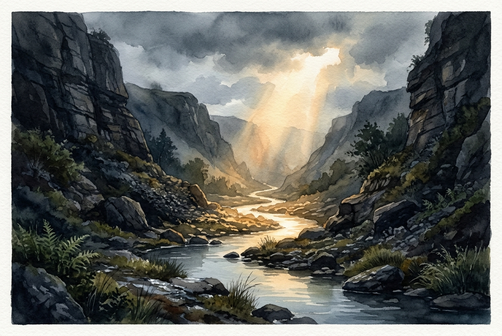

# Leitura Diária: Psalm 23

*24 de outubro de 2026*

> *(Image: A tranquil stream winding through a steep, shadowed rocky valley, illuminated by a warm, golden beam of sunlight breaking through heavy clouds.)*

## A Leitura (PT-NVI)

**Psalm 23**

> 1 O Senhor é o meu pastor; de nada terei falta. 2 Em verdes pastagens me faz repousar e me conduz a águas tranqüilas; 3 restaura-me o vigor. Guia-me nas veredas da justiça por amor do seu nome. 4 Mesmo quando eu andar por um vale de trevas e morte, não temerei perigo algum, pois tu estás comigo; a tua vara e o teu cajado me protegem. 5 Preparas um banquete para mim à vista dos meus inimigos. Tu me honras, ungindo a minha cabeça com óleo e fazendo transbordar o meu cálice. 6 Sei que a bondade e a fidelidade me acompanharão todos os dias da minha vida, e voltarei à casa do Senhor enquanto eu viver.

## A História

No antigo Oriente Médio, cuidar de um rebanho era uma tarefa árdua que exigia vigilância constante para garantir pastos seguros e água fresca. Na metade deste poema ancestral, a imagem muda de uma paisagem rural para a intimidade de um anfitrião recebendo um viajante. Nas culturas nômades, oferecer uma refeição e ungir um visitante eram atos profundos de hospitalidade e aliança. Uma vez que alguém era recebido na tenda, o anfitrião tinha o dever de honra de defendê-lo contra qualquer ameaça externa. O autor une essas metáforas para descrever uma presença divina que não apenas navega por terrenos traiçoeiros, mas também oferece proteção acolhedora.

## Aplicação para Hoje

Muitas vezes desejamos que nossas vidas sejam totalmente livres de ameaças ou transições difíceis. No entanto, este texto não promete a ausência de sombras ou adversários. Em vez disso, ancora nossa esperança na proximidade de um guia que conhece o caminho a seguir. Quando a exaustão se instala ou as circunstâncias parecem esmagadoras, você não precisa fabricar sua própria segurança. Existe um espaço de acolhimento já reservado para você, um lugar de restauração silenciosa bem no meio das suas lutas. Você pode fazer uma pausa, confiando que é profundamente amado e que uma graça implacável acompanha seus passos.

---

*Citações bíblicas extraídas da Nova Versão Internacional (NVI), © 1993, 2000 por Biblica, Inc. Usado com permissão.*
