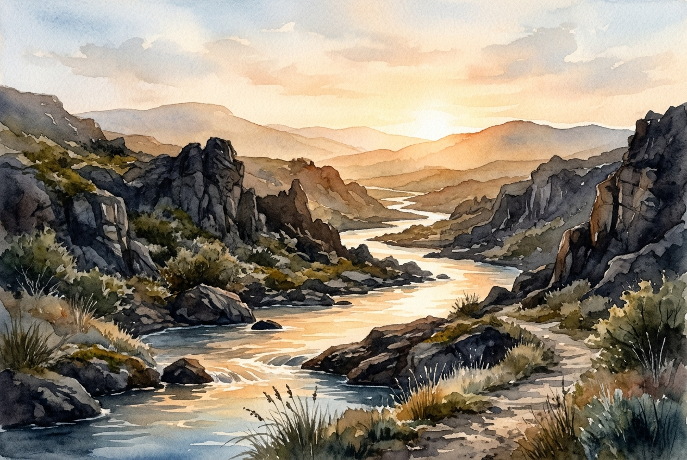

# Leitura Diária: Psalm 46

*24 de outubro de 2026*

> *(Image: A serene, glowing river flowing gently through a rugged landscape of dark, jagged rocks under a soft morning light.)*

## A Leitura (PT-NVI)

**Psalm 46**

> 1 Deus é o nosso refúgio e a nossa fortaleza, auxílio sempre presente na adversidade. 2 Por isso não temeremos, embora a terra trema e os montes afundem no coração do mar, 3 embora estrondem as suas águas turbulentas e os montes sejam sacudidos pela sua fúria. Pausa 4 Há um rio cujos canais alegram a cidade de Deus, o Santo Lugar onde habita o Altíssimo. 5 Deus nela está! Não será abalada! Deus vem em seu auxílio desde o romper da manhã. 6 Nações se agitam, reinos se abalam; ele ergue a voz, e a terra se derrete. 7 O Senhor dos Exércitos está conosco; o Deus de Jacó é a nossa torre segura. Pausa 8 Venham! Vejam as obras do Senhor, seus feitos estarrecedores na terra. 9 Ele dá fim às guerras até os confins da terra; quebra o arco e despedaça a lança, destrói os escudos com fogo. 10 "Parem de lutar! Saibam que eu sou Deus! Serei exaltado entre as nações, serei exaltado na terra. " 11 O Senhor dos Exércitos está conosco; o Deus de Jacó é a nossa torre segura. Pausa

## A História

A cosmologia do antigo Oriente Médio costumava retratar o mar como uma força de caos indomável e destruição. Neste cântico, o autor imagina os piores desastres naturais e políticos possíveis, descrevendo montanhas desmoronando, oceanos em fúria e impérios se desfazendo. No entanto, bem no meio dessa visão apocalíptica, as imagens mudam drasticamente. Em vez de um oceano barulhento, há um rio suave e vivificante fluindo por uma cidade segura. Esse rio representa a presença divina, silenciosa e sustentadora, oferecendo uma alternativa ao pânico ao redor. Os antigos poetas entendiam que a verdadeira segurança não se encontrava em muralhas inquebráveis, mas na fonte constante de vida que habitava no interior.

## Aplicação para Hoje

Quando nossos mundos pessoais parecem estar tremendo, nosso instinto geralmente é lutar com mais força ou entrar em pânico. Observamos as notícias ou olhamos para nossas próprias circunstâncias e sentimos o chão ceder sob nossos pés. O convite aqui não é para ignorar o caos, mas para localizar uma fonte de poder totalmente diferente. Somos chamados a baixar nossas defesas, cessar nossos esforços frenéticos e simplesmente reconhecer quem realmente está sustentando o mundo. A verdadeira resiliência vem de nos conectarmos a essa corrente interna e silenciosa de paz, em vez de tentarmos gritar mais alto que a tempestade. Podemos reencontrar nosso equilíbrio ao pausarmos o tempo suficiente para lembrar que somos amparados por um amor que sobrevive a qualquer crise.

---

*Citações bíblicas extraídas da Nova Versão Internacional (NVI), © 1993, 2000 por Biblica, Inc. Usado com permissão.*
