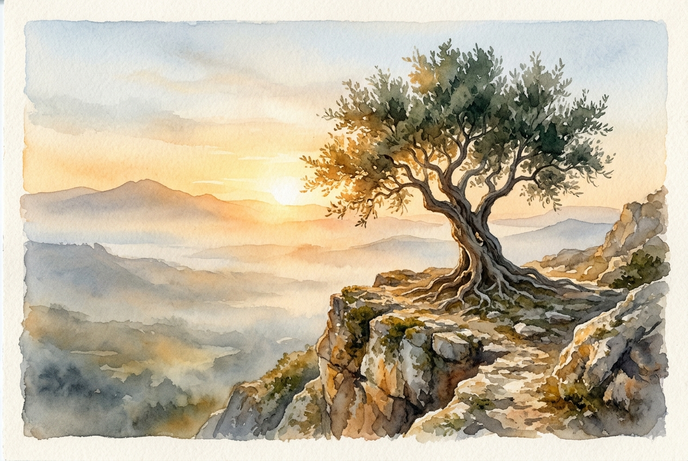

# Daily Reading: Romans 5:1-11

*October 26, 2026*

> *(Image: A single deep-rooted olive tree standing firm on a rocky cliff as dawn breaks, casting a warm golden light through morning mist.)*

## The Reading (NLT)

**Romans 5:1-11**

> 1 Therefore, since we have been made right in God's sight by faith, we have peace with God because of what Jesus Christ our Lord has done for us. 2 Because of our faith, Christ has brought us into this place of undeserved privilege where we now stand, and we confidently and joyfully look forward to sharing God's glory. 3 We can rejoice, too, when we run into problems and trials, for we know that they help us develop endurance. 4 And endurance develops strength of character, and character strengthens our confident hope of salvation. 5 And this hope will not lead to disappointment. For we know how dearly God loves us, because he has given us the Holy Spirit to fill our hearts with his love. 6 When we were utterly helpless, Christ came at just the right time and died for us sinners. 7 Now, most people would not be willing to die for an upright person, though someone might perhaps be willing to die for a person who is especially good. 8 But God showed his great love for us by sending Christ to die for us while we were still sinners. 9 And since we have been made right in God's sight by the blood of Christ, he will certainly save us from God's condemnation. 10 For since our friendship with God was restored by the death of his Son while we were still his enemies, we will certainly be saved through the life of his Son. 11 So now we can rejoice in our wonderful new relationship with God because our Lord Jesus Christ has made us friends of God.

## The Story

In his letter to the Romans, Paul makes a profound pivot. After spending pages arguing that human effort cannot bridge the gap between humanity and the divine, he transitions to the beautiful aftermath of faith. He moves away from the language of a courtroom and into the warmth of a restored relationship. The author outlines a striking progression where hardship is no longer a sign of divine anger, but a catalyst. He traces a path from suffering to endurance, then to character, and finally to a hope that remains unshaken. This sequence rests entirely on an unearned love, proven definitively when humanity was at its most distant and helpless state.

## Application for Today

It is deeply human to interpret our struggles as evidence that we have been abandoned. Yet, this passage offers a radically different perspective on the difficult seasons of our lives. Because our standing with God is secured by grace rather than our own perfection, the pressure of a trial is transformed. It becomes the very environment where resilience is forged and genuine character takes root. We do not have to manufacture this hope on our own. It is a quiet confidence anchored in a love that pursued us at our absolute worst, assuring us that we are held fast no matter what we face today.

---

*Scripture quotations are taken from the Holy Bible, New Living Translation, copyright © 1996, 2004, 2015 by Tyndale House Foundation. Used by permission of Tyndale House Publishers.*
