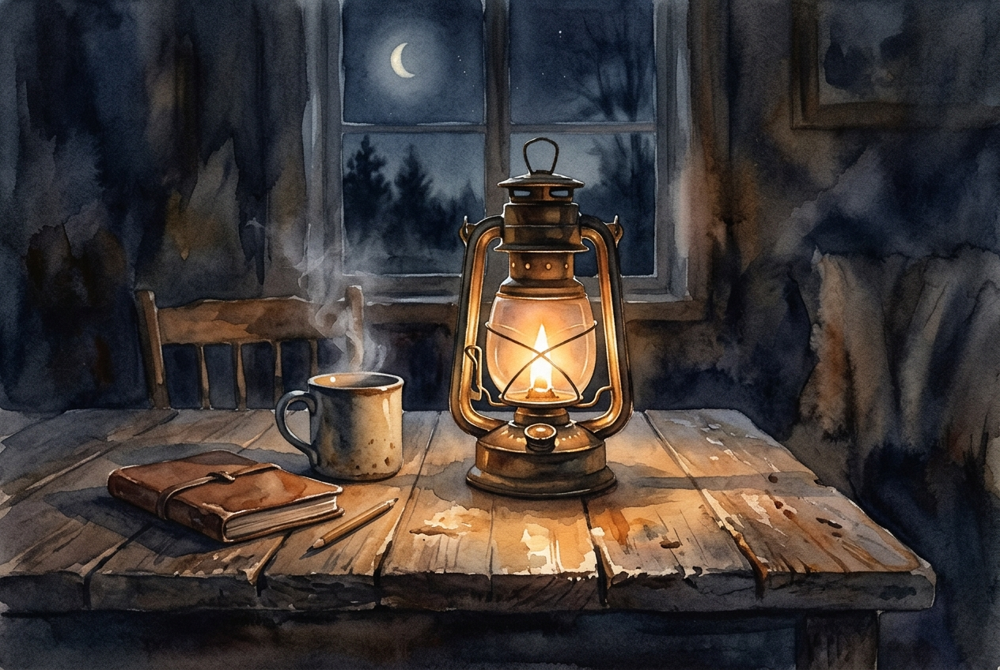

# Leitura Diária: 1 John 4:7-16

*27 de outubro de 2026*

> *(Image: A warm glowing lantern sitting on a rustic wooden table casting a soft inviting light into a darkened room.)*

## A Leitura (PT-NVI)

**1 John 4:7-16**

> 7 Amados, amemo-nos uns aos outros, pois o amor procede de Deus. Aquele que ama é nascido de Deus e conhece a Deus. 8 Quem não ama não conhece a Deus, porque Deus é amor. 9 Foi assim que Deus manifestou o seu amor entre nós: enviou o seu Filho Unigênito ao mundo, para que pudéssemos viver por meio dele. 10 Nisto consiste o amor: não em que nós tenhamos amado a Deus, mas em que ele nos amou e enviou seu Filho como propiciação pelos nossos pecados. 11 Amados, visto que Deus assim nos amou, nós também devemos amar-nos uns aos outros. 12 Ninguém jamais viu a Deus; se nos amarmos uns aos outros, Deus permanece em nós, e o seu amor está aperfeiçoado em nós. 13 Sabemos que permanecemos nele, e ele em nós, porque ele nos deu do seu Espírito. 14 E vimos e testemunhamos que o Pai enviou seu Filho para ser o Salvador do mundo. 15 Se alguém confessa publicamente que Jesus é o Filho de Deus, Deus permanece nele, e ele em Deus. 16 Assim conhecemos o amor que Deus tem por nós e confiamos nesse amor. Deus é amor. Todo aquele que permanece no amor permanece em Deus, e Deus nele.

## A História

A comunidade cristã primitiva que recebeu esta carta estava se fragmentando sob o peso de divisões internas e debates sobre a verdade espiritual. Alguns membros acreditavam possuir um conhecimento superior e secreto sobre o divino, que os colocava acima dos fiéis comuns. O autor rebate essa ideia redefinindo completamente o que significa conhecer o Criador. A verdadeira maturidade espiritual, insiste o texto, não se encontra em sabedoria esotérica, mas na prática tangível de cuidar uns dos outros. O escritor fundamenta esse argumento na própria natureza divina, explicando que a essência do Criador foi revelada de forma definitiva por meio do sacrifício do Filho. Portanto, qualquer alegação de iluminação espiritual que ignore a compaixão humana é, em última análise, vazia.

## Aplicação para Hoje

Muitas vezes buscamos o divino em momentos espetaculares, em retiros silenciosos ou em profundas reflexões teológicas. No entanto, esta passagem oferece uma alternativa incrivelmente prática para experimentarmos o sagrado em nosso cotidiano. O texto sugere que o Criador invisível se torna tangivelmente presente bem no meio de nossas interações mais comuns. Quando você escolhe ser paciente com um colega difícil, perdoa um amigo ou ajuda um vizinho necessitado, está fazendo muito mais do que apenas ser gentil. Você está, de fato, participando da natureza divina e tornando visível na terra a realidade invisível dos céus. O cuidado ativo que temos uns com os outros é o exato lugar onde o sagrado escolhe habitar.

---

*Citações bíblicas extraídas da Nova Versão Internacional (NVI), © 1993, 2000 por Biblica, Inc. Usado com permissão.*
