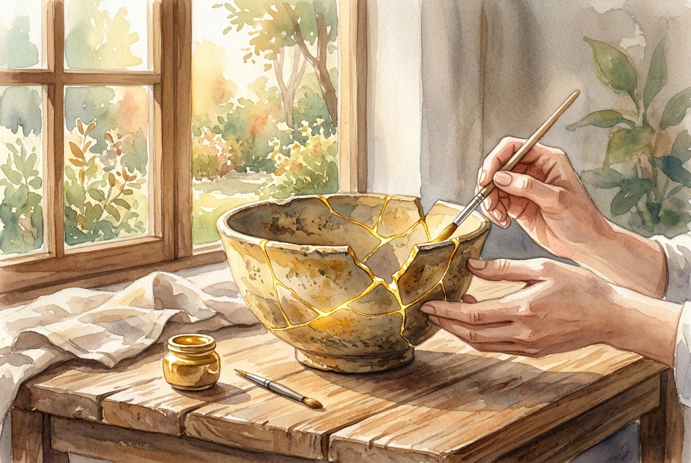

# Leitura Diária: Ephesians 2:1-10

*27 de outubro de 2026*

> *(Image: A piece of weathered, broken pottery being carefully repaired with luminous gold in the kintsugi style, resting on a sunlit wooden table.)*

## A Leitura (PT-NVI)

**Ephesians 2:1-10**

> 1 Vocês estavam mortos em suas transgressões e pecados, 2 nos quais costumavam viver, quando seguiam a presente ordem deste mundo e o príncipe do poder do ar, o espírito que agora está atuando nos que vivem na desobediência. 3 Anteriormente, todos nós também vivíamos entre eles, satisfazendo as vontades da nossa carne, seguindo os seus desejos e pensamentos. Como os outros, éramos por natureza merecedores da ira. 4 Todavia, Deus, que é rico em misericórdia, pelo grande amor com que nos amou, 5 deu-nos vida juntamente com Cristo, quando ainda estávamos mortos em transgressões — pela graça vocês são salvos. 6 Deus nos ressuscitou com Cristo e com ele nos fez assentar nos lugares celestiais em Cristo Jesus, 7 para mostrar, nas eras que hão de vir, a incomparável riqueza de sua graça, demonstrada em sua bondade para conosco em Cristo Jesus. 8 Pois vocês são salvos pela graça, por meio da fé, e isto não vem de vocês, é dom de Deus; 9 não por obras, para que ninguém se glorie. 10 Porque somos criação de Deus realizada em Cristo Jesus para fazermos boas obras, as quais Deus preparou de antemão para que nós as praticássemos.

## A História

No antigo mundo greco-romano, o status era frequentemente construído com base em realizações pessoais, linhagem e ostentação pública. A carta aos efésios subverte radicalmente essa norma cultural ao descrever o estado espiritual natural da humanidade como inteiramente desamparado e alienado do divino. O autor traça um forte contraste entre um passado definido por impulsos destrutivos e um presente marcado por um resgate imerecido. Esse resgate depende inteiramente da misericórdia divina, e não do esforço humano, eliminando qualquer base para o orgulho espiritual. O ponto de virada do texto reside no amor abundante de Deus, que intervém na disfunção humana. Os cristãos não são descritos como pessoas que alcançaram o sucesso por conta própria, mas como indivíduos resgatados e trazidos de volta à vida.

## Aplicação para Hoje

É fácil cair na mentalidade exaustiva de que precisamos conquistar nosso valor por meio de esforço constante e perfeição moral. Muitas vezes tratamos nossa vida espiritual como um currículo que estamos construindo para impressionar o divino. No entanto, este texto nos lembra que nossa transformação é inteiramente um presente, libertando-nos do fardo pesado de tentar salvar a nós mesmos. Quando compreendemos que já somos totalmente amados e refeitos pela graça, nossa perspectiva muda. Somos libertos para olhar ao redor e participar das coisas boas que Deus já está fazendo no mundo. Nossos atos de compaixão e serviço não são mais tentativas desesperadas de provar nosso valor, mas a expressão natural de uma vida que foi lindamente restaurada.

---

*Citações bíblicas extraídas da Nova Versão Internacional (NVI), © 1993, 2000 por Biblica, Inc. Usado com permissão.*
