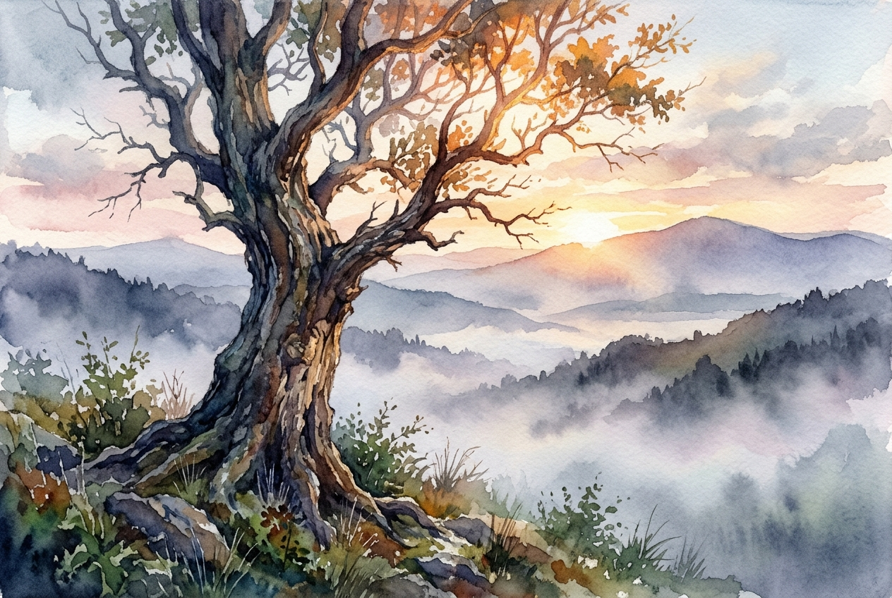

# Leitura Diária: 2 Corinthians 4:16-18

*28 de outubro de 2026*

> *(Image: A weathered, ancient tree with rough bark stands resiliently in a misty valley, its upper branches glowing vibrantly in the warm light of a breaking dawn.)*

## A Leitura (PT-NVI)

**2 Corinthians 4:16-18**

> 16 Por isso não desanimamos. Embora exteriormente estejamos a desgastar-nos, interiormente estamos sendo renovados dia após dia, 17 pois os nossos sofrimentos leves e momentâneos estão produzindo para nós uma glória eterna que pesa mais do que todos eles. 18 Assim, fixamos os olhos, não naquilo que se vê, mas no que não se vê, pois o que se vê é transitório, mas o que não se vê é eterno.

## A História

Paulo escrevia para uma comunidade em Corinto que valorizava muito o status, a aparência física e o sucesso visível. Em total contraste, a própria vida do apóstolo era marcada por naufrágios, perseguições e uma exaustão constante. Ele não negava a realidade do declínio físico ou o peso que a vida impõe ao corpo humano. No entanto, ele usou esse desgaste exterior para destacar uma realidade oculta e vibrante que acontecia em seu interior. O apóstolo estava convidando seus amigos a reconhecerem um fluxo de vida mais profundo, que permanece intacto diante do envelhecimento ou das dificuldades passageiras.

## Aplicação para Hoje

É incrivelmente fácil sermos consumidos por aquilo que está bem na nossa frente, especialmente quando envolve dor, o passar dos anos ou decepções profundas. As lutas que enfrentamos são muito reais e podem parecer esmagadoras no momento. Contudo, essa passagem nos convida a mudar um pouco o nosso foco, olhando além do horizonte imediato para algo muito mais duradouro. A verdadeira renovação costuma acontecer de forma silenciosa, nos espaços escondidos do nosso coração, mesmo quando as circunstâncias continuam difíceis. Ao ancorarmos nossa atenção na eternidade, encontramos a força serena para continuar caminhando, confiando que as dificuldades atuais não são a palavra final.

---

*Citações bíblicas extraídas da Nova Versão Internacional (NVI), © 1993, 2000 por Biblica, Inc. Usado com permissão.*
