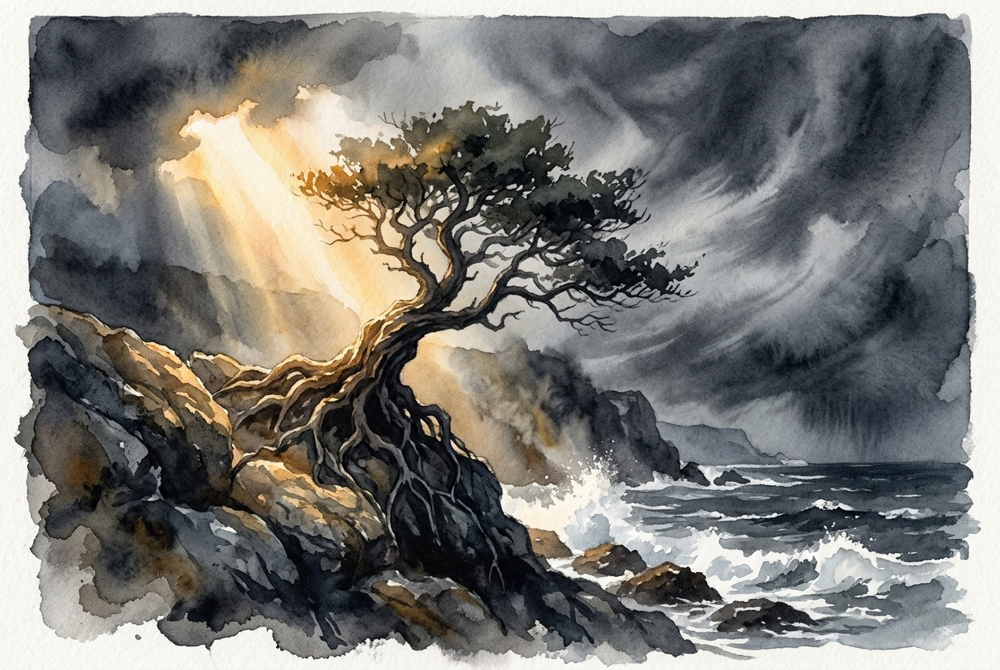

# Daily Reading: Romans 8:31-39

*October 29, 2026*

> *(Image: A solitary, ancient tree with deep, thick roots gripping a rocky cliffside, standing firm against a turbulent storm while bathed in a warm, piercing ray of golden sunlight.)*

## The Reading (NLT)

**Romans 8:31-39**

> 31 What shall we say about such wonderful things as these? If God is for us, who can ever be against us? 32 Since he did not spare even his own Son but gave him up for us all, won't he also give us everything else? 33 Who dares accuse us whom God has chosen for his own? No one for God himself has given us right standing with himself. 34 Who then will condemn us? No one for Christ Jesus died for us and was raised to life for us, and he is sitting in the place of honor at God's right hand, pleading for us. 35 Can anything ever separate us from Christ's love? Does it mean he no longer loves us if we have trouble or calamity, or are persecuted, or hungry, or destitute, or in danger, or threatened with death? 36 (As the Scriptures say, For your sake we are killed every day; we are being slaughtered like sheep.) 37 No, despite all these things, overwhelming victory is ours through Christ, who loved us. 38 And I am convinced that nothing can ever separate us from God's love. Neither death nor life, neither angels nor demons, neither our fears for today nor our worries about tomorrow not even the powers of hell can separate us from God's love. 39 No power in the sky above or in the earth below indeed, nothing in all creation will ever be able to separate us from the love of God that is revealed in Christ Jesus our Lord.

## The Story

Paul is writing to a community in the heart of an empire where life is cheap and power is absolute. The Roman believers live under the constant shadow of political instability, social marginalization, and the threat of violence. Using the language of a courtroom, Paul addresses their deepest insecurities by systematically dismantling every potential accusation or threat. He lists the most extreme physical and cosmic terrors imaginable in the ancient world. Yet, instead of promising an escape from these harsh realities, he redefines victory entirely. The triumph he describes is not the absence of suffering, but the unbreakable presence of divine solidarity within it.

## Application for Today

We still face a world that feels overwhelmingly fragile, where illness, economic instability, and relational breakdown threaten our sense of security. It is easy to interpret our hardships as evidence of divine abandonment or personal failure. However, this passage invites us into a radically different perspective. Our ultimate safety does not depend on our ability to avoid pain, but on the relentless grip of a love that has already bridged the gap between heaven and earth. When we feel most vulnerable, we can rest in the reality that the one who holds us has already overcome the worst the world can offer. Nothing we encounter today has the power to sever that connection.

---

*Scripture quotations are taken from the Holy Bible, New Living Translation, copyright © 1996, 2004, 2015 by Tyndale House Foundation. Used by permission of Tyndale House Publishers.*
