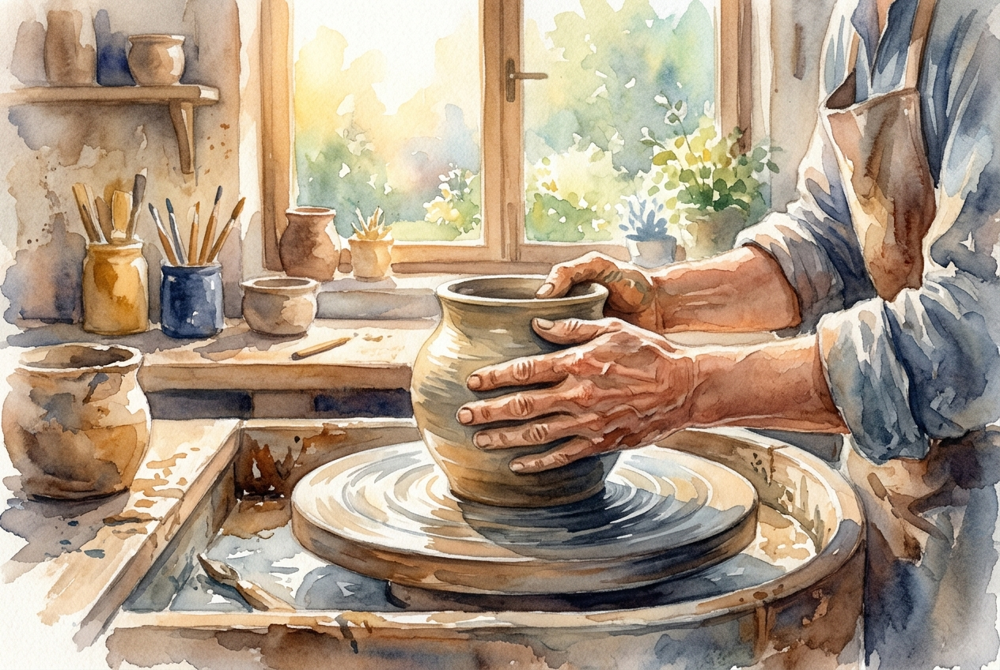

# Leitura Diária: Romans 12:1-2

*29 de outubro de 2026*

> *(Image: A potter's hands gently shaping a vessel of clay on a spinning wheel, illuminated by warm morning sunlight.)*

## A Leitura (PT-NVI)

**Romans 12:1-2**

> 1 Portanto, irmãos, rogo-lhes pelas misericórdias de Deus que se ofereçam em sacrifício vivo, santo e agradável a Deus; este é o culto racional de vocês. 2 Não se amoldem ao padrão deste mundo, mas transformem-se pela renovação da sua mente, para que sejam capazes de experimentar e comprovar a boa, agradável e perfeita vontade de Deus.

## A História

Paulo escreve para uma comunidade cercada pela cultura avassaladora do Império Romano. Nessa sociedade antiga, o valor de alguém era medido pelo poder, pelo status e pela conformidade rígida às expectativas imperiais. A adoração religiosa da época geralmente envolvia o sacrifício de animais em templos para apaziguar deuses distantes e exigentes. Paulo subverte completamente esse sistema ao convidar esses primeiros cristãos a enxergarem suas vidas cotidianas como o verdadeiro local de adoração. Em vez de algo morto em um altar, a oferta deles deveria ser viva, ativa e continuamente moldada pela misericórdia divina, não pelas exigências de Roma.

## Aplicação para Hoje

Todos os dias, sofremos pressões para nos encaixarmos nos moldes que a sociedade cria para nós. O mundo ainda exige conformidade, incentivando a busca incansável por status, riqueza ou aprovação alheia. No entanto, a verdadeira transformação acontece quando permitimos que nossos pensamentos e suposições mais profundas sejam refeitos por um conjunto de valores totalmente diferente. Ao entregarmos nossos hábitos e interações diárias a Deus, deixamos para trás o ciclo exaustivo de tentar sempre provar nosso valor. Começamos a ver nossa rotina comum como um espaço para o propósito divino, descobrindo uma maneira de viver que traz paz e sentido reais.

---

*Citações bíblicas extraídas da Nova Versão Internacional (NVI), © 1993, 2000 por Biblica, Inc. Usado com permissão.*
