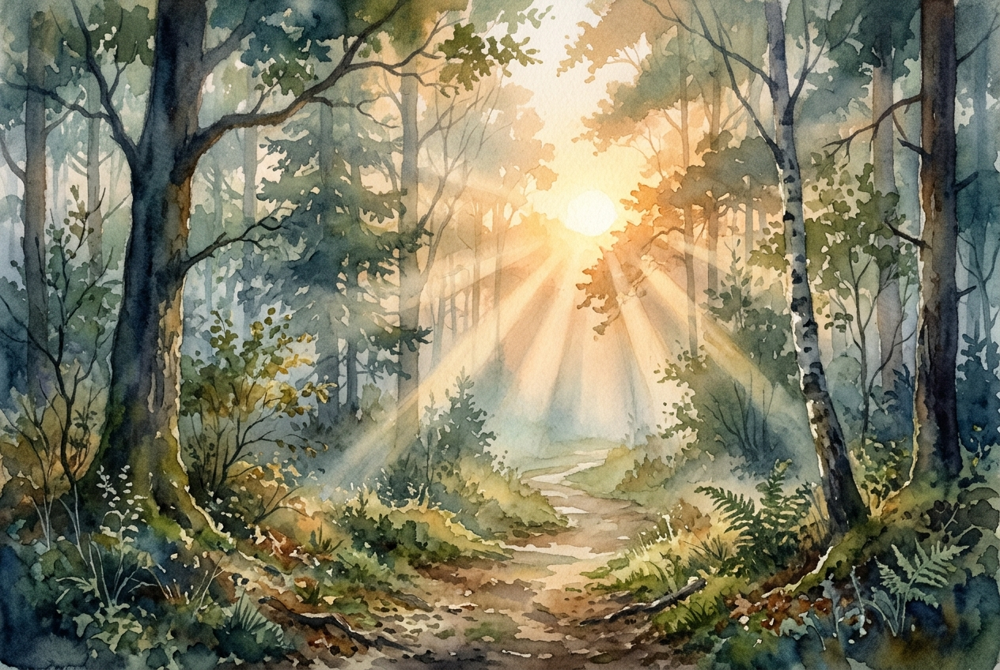

# Leitura Diária: John 3:16-21

*30 de outubro de 2026*

> *(Image: A warm, golden sunrise breaks through a dense, misty forest, casting long rays of light that illuminate a clear path.)*

## A Leitura (PT-NVI)

**John 3:16-21**

> 16 "Porque Deus tanto amou o mundo que deu o seu Filho Unigênito, para que todo o que nele crer não pereça, mas tenha a vida eterna. 17 Pois Deus enviou o seu Filho ao mundo, não para condenar o mundo, mas para que este fosse salvo por meio dele. 18 Quem nele crê não é condenado, mas quem não crê já está condenado, por não crer no nome do Filho Unigênito de Deus. 19 Este é o julgamento: a luz veio ao mundo, mas os homens amaram as trevas, e não a luz, porque as suas obras eram más. 20 Quem pratica o mal odeia a luz e não se aproxima da luz, temendo que as suas obras sejam manifestas. 21 Mas quem pratica a verdade vem para a luz, para que se veja claramente que as suas obras são realizadas por intermédio de Deus".

## A História

Nicodemos procura seu encontro à meia-noite buscando respostas sem chamar a atenção para si mesmo. Nesse encontro silencioso e cercado por sombras, a conversa revela uma missão de resgate divino baseada inteiramente no amor, e não na condenação. A narrativa contrasta a falsa segurança que as pessoas encontram na escuridão com a presença iluminadora do divino. Isso sugere que esconder nossas falhas é um reflexo humano natural, enraizado no medo da exposição e do julgamento. No entanto, a intenção divina não é envergonhar o mundo, mas oferecer um caminho para fora das sombras. A luz chega como um farol de resgate, convidando a humanidade a sair de seus esconderijos.

## Aplicação para Hoje

É muito fácil presumir que, se o nosso verdadeiro eu fosse totalmente visto, enfrentaríamos um julgamento severo. Muitas vezes nos retiramos para nossas próprias versões de escuridão, mantendo nossas lutas, medos e fracassos escondidos dos outros e de Deus. Mas o convite divino vira essa expectativa de cabeça para baixo. A luz não é oferecida como um holofote implacável para expor e humilhar, mas como o calor do sol da manhã que traz cura. Dar um passo em direção a essa luz significa confiar que somos amados o suficiente para sermos resgatados, e não condenados. Quando nos permitimos ser verdadeiramente vistos, descobrimos que a graça que nos espera é muito maior do que o nosso medo. Podemos caminhar na verdade, sabendo que a obra que está sendo feita em nós é guiada pelo amor.

---

*Citações bíblicas extraídas da Nova Versão Internacional (NVI), © 1993, 2000 por Biblica, Inc. Usado com permissão.*
