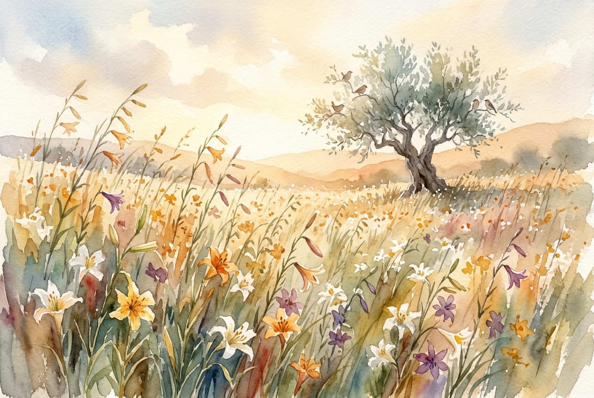

# Leitura Diária: Matthew 6:25-34

*30 de outubro de 2026*

> *(Image: A sunlit field of wild lilies swaying gently in a morning breeze, with a few small birds resting on the branches of a distant olive tree.)*

## A Leitura (PT-NVI)

**Matthew 6:25-34**

> 25 "Portanto eu lhes digo: não se preocupem com suas próprias vidas, quanto ao que comer ou beber; nem com seus próprios corpos, quanto ao que vestir. Não é a vida mais importante do que a comida, e o corpo mais importante do que a roupa? 26 Observem as aves do céu: não semeiam nem colhem nem armazenam em celeiros; contudo, o Pai celestial as alimenta. Não têm vocês muito mais valor do que elas? 27 Quem de vocês, por mais que se preocupe, pode acrescentar uma hora que seja à sua vida? 28 "Por que vocês se preocupam com roupas? Vejam como crescem os lírios do campo. Eles não trabalham nem tecem. 29 Contudo, eu lhes digo que nem Salomão, em todo o seu esplendor, vestiu-se como um deles. 30 Se Deus veste assim a erva do campo, que hoje existe e amanhã é lançada ao fogo, não vestirá muito mais a vocês, homens de pequena fé? 31 Portanto, não se preocupem, dizendo: ‘Que vamos comer? ’ ou ‘que vamos beber? ’ ou ‘que vamos vestir? ’ 32 Pois os pagãos é que correm atrás dessas coisas; mas o Pai celestial sabe que vocês precisam delas. 33 Busquem, pois, em primeiro lugar o Reino de Deus e a sua justiça, e todas essas coisas lhes serão acrescentadas. 34 Portanto, não se preocupem com o amanhã, pois o amanhã se preocupará consigo mesmo. Basta a cada dia o seu próprio mal".

## A História

No mundo antigo, a sobrevivência diária era uma preocupação constante e opressiva. A maioria das pessoas que ouviam os ensinamentos naquela encosta era composta por camponeses e trabalhadores que conheciam intimamente a incerteza das colheitas e a dureza das exigências do império. Ao abordar a ansiedade daquela multidão, a intenção não é minimizar necessidades físicas muito reais. Em vez disso, o olhar do público é redirecionado para o mundo natural ao redor deles. Apontando para as aves e as flores silvestres, o discurso usa a própria criação como prova viva de um cuidado contínuo. O convite é para que percebam que a mesma atenção divina dedicada à natureza efêmera está voltada de forma ainda mais profunda para eles.

## Aplicação para Hoje

A ansiedade frequentemente arrasta nossas mentes para as sombras de um futuro não escrito, fazendo-nos carregar fardos que ainda nem chegaram. Nós nos esgotamos tentando proteger nossas próprias vidas contra todas as vulnerabilidades possíveis. No entanto, o chamado aqui é para voltar à luz do momento presente e confiar em um amor que já conhece as nossas carências. Ao focar no dia de hoje, libertamos nossas mãos da tarefa impossível de controlar o amanhã. Somos convidados a buscar um reino maior e a descansar em um Pai que sustenta. O dia de hoje já traz suas próprias demandas, e a graça é entregue diariamente, não por antecipação.

---

*Citações bíblicas extraídas da Nova Versão Internacional (NVI), © 1993, 2000 por Biblica, Inc. Usado com permissão.*
