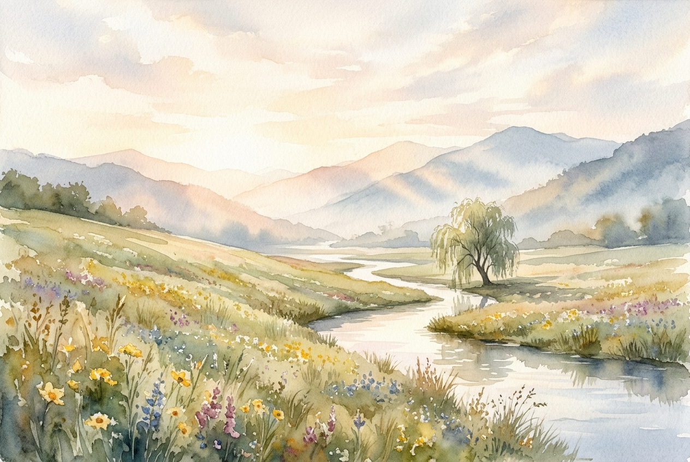

# Leitura Diária: Psalm 23

*31 de outubro de 2026*

> *(Image: A serene sunlit meadow gently sloping down toward a calm winding stream with distant misty mountains casting soft shadows in the early morning light.)*

## A Leitura (PT-NVI)

**Psalm 23**

> 1 O Senhor é o meu pastor; de nada terei falta. 2 Em verdes pastagens me faz repousar e me conduz a águas tranqüilas; 3 restaura-me o vigor. Guia-me nas veredas da justiça por amor do seu nome. 4 Mesmo quando eu andar por um vale de trevas e morte, não temerei perigo algum, pois tu estás comigo; a tua vara e o teu cajado me protegem. 5 Preparas um banquete para mim à vista dos meus inimigos. Tu me honras, ungindo a minha cabeça com óleo e fazendo transbordar o meu cálice. 6 Sei que a bondade e a fidelidade me acompanharão todos os dias da minha vida, e voltarei à casa do Senhor enquanto eu viver.

## A História

O cântico mais famoso de Davi reflete sua própria vivência cuidando de rebanhos no deserto da Judeia. Naquela paisagem árida, encontrar pastagens seguras e fontes de água exigia um conhecimento profundo do terreno e vigilância constante. A poesia transita de forma fluida da imagem de um guia protetor em desfiladeiros perigosos para a de um anfitrião generoso. No antigo Oriente Médio, ungir um convidado e oferecer-lhe uma taça farta eram os maiores sinais de honra e acolhimento. O texto muda de falar sobre o guia divino para falar diretamente com ele no momento de maior vulnerabilidade. Essa mudança de tom revela uma intimidade profunda que transforma o medo em confiança serena.

## Aplicação para Hoje

Muitas vezes vivemos em um ritmo frenético, buscando segurança em nossas conquistas ou no trabalho exaustivo. No entanto, este antigo poema nos convida a reconhecer um cuidado que não depende do nosso próprio esforço. Quando enfrentamos períodos de luto ou incerteza, a promessa não é que as sombras desaparecerão num passe de mágica. Pelo contrário, a garantia é a de uma presença constante caminhando ao nosso lado. Somos convidados a uma mesa de graça bem no centro de nossos conflitos e ansiedades. Perceber essa companhia inabalável nos permite finalmente parar de lutar e encontrar verdadeiro repouso.

---

*Citações bíblicas extraídas da Nova Versão Internacional (NVI), © 1993, 2000 por Biblica, Inc. Usado com permissão.*
