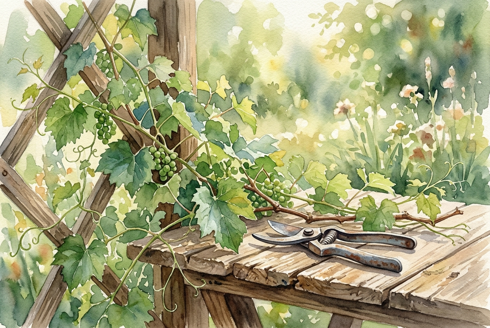

# Daily Reading: John 15:1-11

*November 1, 2026*

> *(Image: A close-up view of a vibrant green grapevine in a sunlit garden, with a pair of antique pruning shears resting gently on a rustic wooden table nearby.)*

## The Reading (NLT)

**John 15:1-11**

> 1 I am the true grapevine, and my Father is the gardener. 2 He cuts off every branch of mine that doesn't produce fruit, and he prunes the branches that do bear fruit so they will produce even more. 3 You have already been pruned and purified by the message I have given you. 4 Remain in me, and I will remain in you. For a branch cannot produce fruit if it is severed from the vine, and you cannot be fruitful unless you remain in me. 5 Yes, I am the vine; you are the branches. Those who remain in me, and I in them, will produce much fruit. For apart from me you can do nothing. 6 Anyone who does not remain in me is thrown away like a useless branch and withers. Such branches are gathered into a pile to be burned. 7 But if you remain in me and my words remain in you, you may ask for anything you want, and it will be granted! 8 When you produce much fruit, you are my true disciples. This brings great glory to my Father. 9 I have loved you even as the Father has loved me. Remain in my love. 10 When you obey my commandments, you remain in my love, just as I obey my Father's commandments and remain in his love. 11 I have told you these things so that you will be filled with my joy. Yes, your joy will overflow!

## The Story

In the ancient Mediterranean world, vineyards were a familiar sight and a powerful symbol of life and sustenance. Jesus uses this everyday imagery during his final meal with his closest friends to explain how their spiritual lives will function after he is gone. He describes a deeply interconnected relationship where the gardener carefully tends the plants to ensure a healthy harvest. This process involves the painful but necessary act of pruning, removing what is dead or overgrown so the plant can thrive. The emphasis is not on the branch struggling to produce grapes on its own, but on the branch staying firmly attached to the source of life. Through this agricultural metaphor, the listeners learn that true vitality comes from an unbroken bond with the vine.

## Application for Today

We often exhaust ourselves trying to manufacture spiritual success through sheer willpower. Yet this passage invites us to shift our focus from frantic production to quiet connection. When we encounter seasons of pruning, times when our schedules, ambitions, or comforts are stripped away, it can feel like a punishment. Instead, these moments are often the careful work of a loving gardener making room for new growth. Our primary task is simply to remain rooted in love, trusting that fruitfulness is a natural byproduct of our closeness to the source. By resting in that connection, we find an enduring sense of joy that external circumstances cannot easily shake. Let go of the pressure to perform today, and simply focus on staying attached.

---

*Scripture quotations are taken from the Holy Bible, New Living Translation, copyright © 1996, 2004, 2015 by Tyndale House Foundation. Used by permission of Tyndale House Publishers.*
