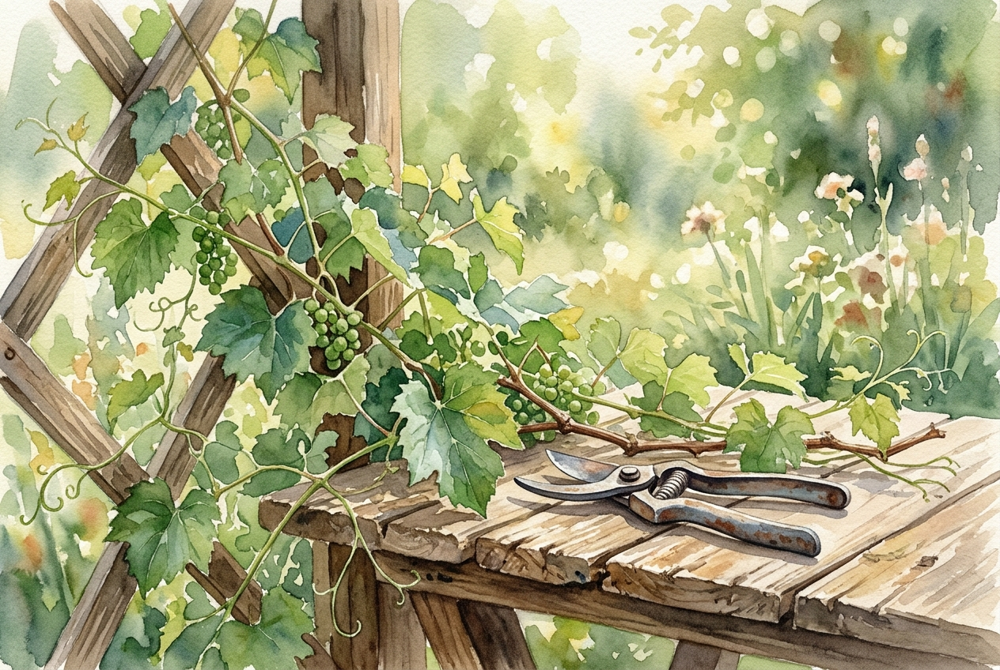

# Leitura Diária: John 15:1-11

*1 de novembro de 2026*

> *(Image: A close-up view of a vibrant green grapevine in a sunlit garden, with a pair of antique pruning shears resting gently on a rustic wooden table nearby.)*

## A Leitura (PT-NVI)

**John 15:1-11**

> 1 "Eu sou a videira verdadeira, e meu Pai é o agricultor. 2 Todo ramo que, estando em mim, não dá fruto, ele corta; e todo que dá fruto ele poda, para que dê mais fruto ainda. 3 Vocês já estão limpos, pela palavra que lhes tenho falado. 4 Permaneçam em mim, e eu permanecerei em vocês. Nenhum ramo pode dar fruto por si mesmo, se não permanecer na videira. Vocês também não podem dar fruto, se não permanecerem em mim. 5 "Eu sou a videira; vocês são os ramos. Se alguém permanecer em mim e eu nele, esse dá muito fruto; pois sem mim vocês não podem fazer coisa alguma. 6 Se alguém não permanecer em mim, será como o ramo que é jogado fora e seca. Tais ramos são apanhados, lançados ao fogo e queimados. 7 Se vocês permanecerem em mim, e as minhas palavras permanecerem em vocês, pedirão o que quiserem, e lhes será concedido. 8 Meu Pai é glorificado pelo fato de vocês darem muito fruto; e assim serão meus discípulos. 9 "Como o Pai me amou, assim eu os amei; permaneçam no meu amor. 10 Se vocês obedecerem aos meus mandamentos, permanecerão no meu amor, assim como tenho obedecido aos mandamentos de meu Pai e em seu amor permaneço. 11 Tenho lhes dito estas palavras para que a minha alegria esteja em vocês e a alegria de vocês seja completa.

## A História

No mundo antigo do Mediterrâneo, os vinhedos eram uma visão comum e um símbolo poderoso de sustento e vitalidade. Jesus utiliza essa imagem cotidiana durante sua última refeição com seus amigos mais próximos para explicar como a vida espiritual deles funcionaria após sua partida. Ele descreve uma relação de profunda interdependência, na qual o agricultor cuida meticulosamente das plantas para garantir uma colheita farta. Esse processo envolve a prática dolorosa, porém essencial, da poda, que remove o que está morto ou excessivo para que a planta possa florescer. O foco não está no esforço solitário do ramo para gerar uvas, mas em sua capacidade de se manter firmemente unido à fonte de vida. Através dessa metáfora agrícola, os ouvintes compreendem que a verdadeira força nasce de um vínculo inquebrável com a videira.

## Aplicação para Hoje

Muitas vezes nos esgotamos tentando forjar algum tipo de sucesso espiritual através da pura força de vontade. No entanto, o texto nos convida a mudar o foco da produção desenfreada para uma conexão silenciosa e constante. Quando enfrentamos estações de poda, momentos em que nossas agendas, ambições ou confortos são cortados, podemos sentir que estamos sendo punidos. Na verdade, essas fases costumam ser o trabalho cuidadoso de um jardineiro amoroso abrindo espaço para um novo crescimento. Nossa principal tarefa é simplesmente permanecer enraizados no amor, confiando que dar frutos é uma consequência natural de nossa proximidade com a fonte. Ao descansarmos nessa ligação, encontramos uma alegria profunda que as circunstâncias externas não podem abalar facilmente. Hoje, abandone a pressão por resultados e concentre-se apenas em manter a sua conexão.

---

*Citações bíblicas extraídas da Nova Versão Internacional (NVI), © 1993, 2000 por Biblica, Inc. Usado com permissão.*
