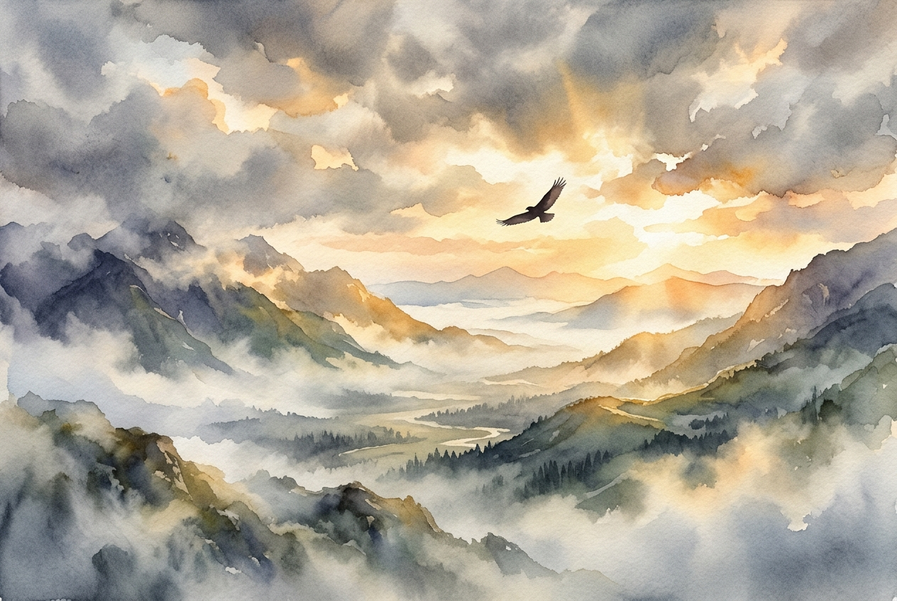

# Daily Reading: Isaiah 40:28-31

*November 1, 2026*

> *(Image: A solitary bird soaring high above a misty mountain valley at dawn, with warm golden light piercing through heavy clouds to illuminate the quiet landscape below.)*

## The Reading (NLT)

**Isaiah 40:28-31**

> 28 Have you never heard? Have you never understood? The Lord is the everlasting God, the Creator of all the earth. He never grows weak or weary. No one can measure the depths of his understanding. 29 He gives power to the weak and strength to the powerless. 30 Even youths will become weak and tired, and young men will fall in exhaustion. 31 But those who trust in the Lord will find new strength. They will soar high on wings like eagles. They will run and not grow weary. They will walk and not faint.

## The Story

The prophet is speaking to a community battered by exile and despair, a people who feel forgotten by their Maker. They are running on empty and questioning if their future holds anything but more hardship. In response, the text shifts their gaze away from their own depleted reserves and toward the vast, untiring nature of the Divine. It contrasts the inevitable burnout of human self-reliance with the boundless energy of the eternal. The imagery here is deeply grounded in the physical reality of weariness, acknowledging that human limits are real and unavoidable. Yet, it introduces a profound shift in how to endure, pointing to a vitality that is received through connection rather than manufactured by effort.

## Application for Today

We live in a culture that constantly demands we push harder, hustle more, and rely entirely on our own grit. When we inevitably hit the wall of our own limitations, we often feel a sense of failure or shame. This passage offers a beautiful alternative to the exhaustion of self-reliance, inviting us to recognize that our weariness is simply part of being human. Instead of demanding we summon energy we do not have, it encourages a posture of quiet trust and receptivity. By resting in the endless capacity of the Divine, we find a different kind of endurance. It is a quiet, steadying power that allows us to keep moving forward, step by step, sustained by a source far greater than ourselves.

---

*Scripture quotations are taken from the Holy Bible, New Living Translation, copyright © 1996, 2004, 2015 by Tyndale House Foundation. Used by permission of Tyndale House Publishers.*
