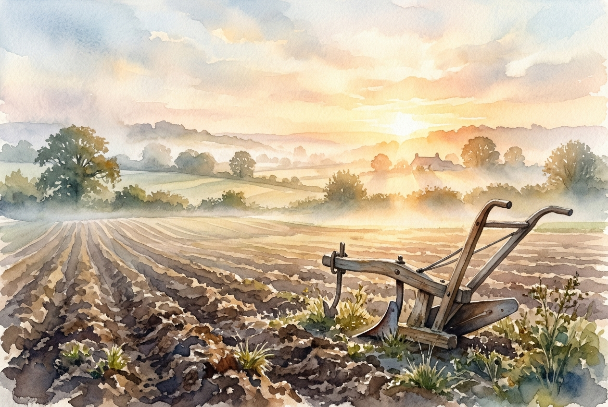

# Daily Reading: Matthew 11:28-30

*November 1, 2026*

> *(Image: A weathered wooden plow resting in a sunlit, freshly tilled field at dawn, with soft golden light breaking through morning mist.)*

## The Reading (NLT)

**Matthew 11:28-30**

> 28 Then Jesus said, Come to me, all of you who are weary and carry heavy burdens, and I will give you rest. 29 Take my yoke upon you. Let me teach you, because I am humble and gentle at heart, and you will find rest for your souls. 30 For my yoke is easy to bear, and the burden I give you is light.

## The Story

In the first-century world, a yoke was an everyday agricultural tool, a heavy wooden beam used to harness two animals together for fieldwork. It was also a common metaphor for the demands of religious teaching or the oppression of an occupying empire. The original listeners knew the crushing weight of both, facing exhaustive behavioral codes demanded by local leaders and the brutal taxation of Rome. They were drained by systems that constantly extracted more than they could give. Into this widespread exhaustion, a teacher from Nazareth presents a startling alternative. He does not offer a life devoid of responsibility, but rather a completely different method of carrying the load.

## Application for Today

Modern life continues to demand endless production, performance, and self-sufficiency. We carry the invisible weights of anxiety, expectations, and the pressure to hold our circumstances together by sheer willpower. The invitation offered in this passage is to stop pulling the plow alone. Stepping into this new dynamic means partnering with someone who leads with profound compassion, allowing him to set the pace and bear the bulk of the weight. This shift requires the humility to admit our exhaustion and the courage to relinquish our need for control. When we finally stop striving to earn our keep or secure our own future, we discover a deep, sustaining relief.

---

*Scripture quotations are taken from the Holy Bible, New Living Translation, copyright © 1996, 2004, 2015 by Tyndale House Foundation. Used by permission of Tyndale House Publishers.*
