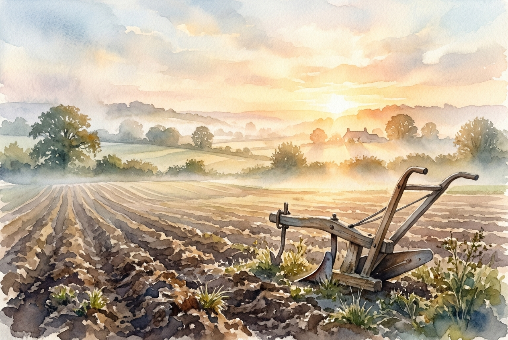

# Leitura Diária: Matthew 11:28-30

*1 de novembro de 2026*

> *(Image: A weathered wooden plow resting in a sunlit, freshly tilled field at dawn, with soft golden light breaking through morning mist.)*

## A Leitura (PT-NVI)

**Matthew 11:28-30**

> 28 "Venham a mim, todos os que estão cansados e sobrecarregados, e eu lhes darei descanso. 29 Tomem sobre vocês o meu jugo e aprendam de mim, pois sou manso e humilde de coração, e vocês encontrarão descanso para as suas almas. 30 Pois o meu jugo é suave e o meu fardo é leve".

## A História

No mundo do primeiro século, o jugo era uma ferramenta agrícola cotidiana, uma pesada viga de madeira usada para unir dois animais no trabalho do campo. Era também uma metáfora comum para as exigências do ensino religioso ou para a opressão de um império dominador. Os ouvintes originais conheciam o peso esmagador de ambos, enfrentando os exaustivos códigos de conduta exigidos pelos líderes locais e a tributação brutal de Roma. Eles estavam esgotados por sistemas que constantemente extraíam mais do que podiam oferecer. Diante dessa exaustão generalizada, um mestre de Nazaré apresenta uma alternativa surpreendente. Ele não oferece uma vida isenta de responsabilidades, mas sim um método completamente diferente de lidar com o peso do cotidiano.

## Aplicação para Hoje

A vida moderna continua a exigir produção, desempenho e autossuficiência de forma implacável. Carregamos os pesos invisíveis da ansiedade, das expectativas e da pressão para manter nossas vidas nos trilhos por pura força de vontade. O convite oferecido nesta passagem é para parar de puxar o arado de forma solitária. Entrar nessa nova dinâmica significa fazer parceria com alguém que lidera com profunda compaixão, permitindo que ele dite o ritmo e suporte a maior parte do peso. Essa mudança exige a humildade de admitir nosso cansaço e a coragem de abrir mão da nossa necessidade de controle. Quando finalmente paramos de lutar para provar nosso valor, descobrimos um alívio profundo e restaurador.

---

*Citações bíblicas extraídas da Nova Versão Internacional (NVI), © 1993, 2000 por Biblica, Inc. Usado com permissão.*
