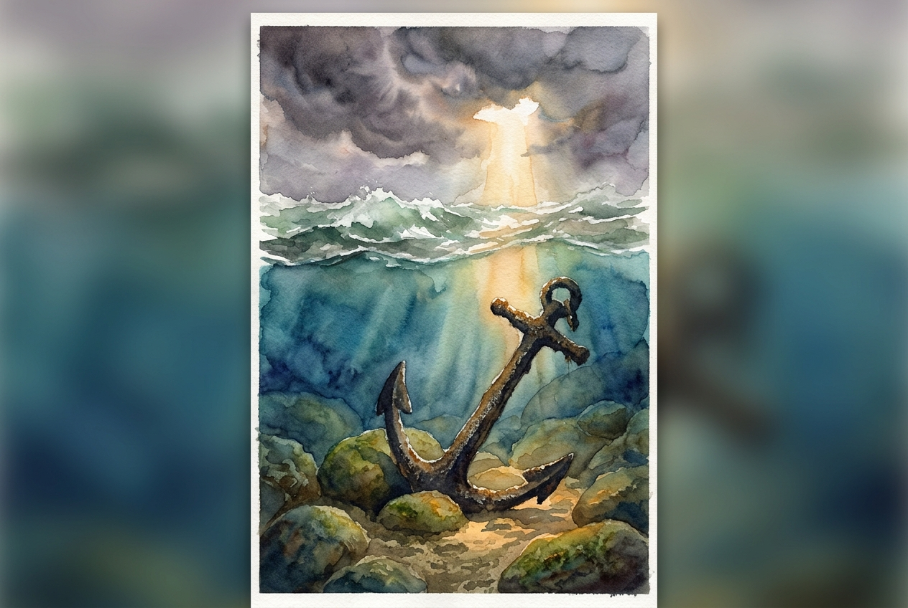

# Daily Reading: James 1:2-8

*November 2, 2026*

> *(Image: A heavy iron anchor resting firmly on a rocky seabed while turbulent ocean waves crash on the surface above, illuminated by a single shaft of sunlight breaking through dark clouds.)*

## The Reading (NLT)

**James 1:2-8**

> 2 Dear brothers and sisters, when troubles of any kind come your way, consider it an opportunity for great joy. 3 For you know that when your faith is tested, your endurance has a chance to grow. 4 So let it grow, for when your endurance is fully developed, you will be perfect and complete, needing nothing. 5 If you need wisdom, ask our generous God, and he will give it to you. He will not rebuke you for asking. 6 But when you ask him, be sure that your faith is in God alone. Do not waver, for a person with divided loyalty is as unsettled as a wave of the sea that is blown and tossed by the wind. 7 Such people should not expect to receive anything from the Lord. 8 Their loyalty is divided between God and the world, and they are unstable in everything they do.

## The Story

The author of this letter writes to a scattered community experiencing intense hardship and social pressure. Rather than offering a quick escape route, he completely reframes their suffering, suggesting that the crucible of difficult times is exactly where resilience is forged. To navigate these challenges, he points them toward a specific kind of wisdom that the Creator offers without hesitation or judgment. The requirement for receiving this clarity is a unified heart. He uses the vivid imagery of a storm-tossed sea to describe the alternative of a person whose loyalties are split, constantly shifting directions and unable to find solid footing.

## Application for Today

We often view difficulties as unwelcome interruptions to our lives, but this passage invites us to see them as the soil where deep endurance grows. When we feel overwhelmed by circumstances, our natural instinct is either to panic or to frantically search for our own solutions. Instead, we are invited to pause and ask for the clarity we lack, trusting that God is eager to provide it. The challenge is to remain steady in that trust. When we divide our reliance between divine guidance and our own anxious attempts to control the outcome, we end up exhausted and adrift. True stability comes from anchoring our focus entirely on the generous character of God.

---

*Scripture quotations are taken from the Holy Bible, New Living Translation, copyright © 1996, 2004, 2015 by Tyndale House Foundation. Used by permission of Tyndale House Publishers.*
