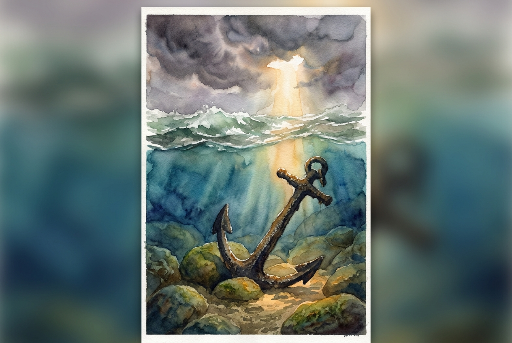

# Leitura Diária: James 1:2-8

*2 de novembro de 2026*

> *(Image: A heavy iron anchor resting firmly on a rocky seabed while turbulent ocean waves crash on the surface above, illuminated by a single shaft of sunlight breaking through dark clouds.)*

## A Leitura (PT-NVI)

**James 1:2-8**

> 2 Meus irmãos, considerem motivo de grande alegria o fato de passarem por diversas provações, 3 pois vocês sabem que a prova da sua fé produz perseverança. 4 E a perseverança deve ter ação completa, a fim de que vocês sejam maduros e íntegros, sem lhes faltar coisa alguma. 5 Se algum de vocês tem falta de sabedoria, peça-a a Deus, que a todos dá livremente, de boa vontade; e lhe será concedida. 6 Peça-a, porém, com fé, sem duvidar, pois aquele que duvida é semelhante à onda do mar, levada e agitada pelo vento. 7 Não pense tal homem que receberá coisa alguma do Senhor; 8 é alguém que tem mente dividida e é instável em tudo o que faz.

## A História

O autor desta carta escreve para uma comunidade dispersa que enfrentava intensas dificuldades e pressões sociais. Em vez de oferecer uma rota de fuga rápida, ele ressignifica completamente o sofrimento deles, sugerindo que o crisol dos tempos difíceis é exatamente onde a resiliência é forjada. Para navegar por esses desafios, ele os direciona a um tipo específico de sabedoria que o Criador oferece sem hesitação ou julgamento. O requisito para receber essa clareza é ter um coração unificado. Ele usa a imagem vívida de um mar agitado por tempestades para descrever a alternativa de uma pessoa com lealdades divididas, mudando de direção constantemente e incapaz de encontrar um terreno firme.

## Aplicação para Hoje

Muitas vezes vemos as dificuldades como interrupções indesejadas em nossas vidas, mas este texto nos convida a encará-las como o solo onde uma perseverança profunda cresce. Quando nos sentimos sobrecarregados pelas circunstâncias, nosso instinto natural é entrar em pânico ou buscar freneticamente nossas próprias soluções. Em vez disso, somos convidados a fazer uma pausa e pedir a clareza que nos falta, confiando que Deus está ansioso para fornecê-la. O desafio é permanecer firme nessa confiança. Quando dividimos nossa dependência entre a orientação divina e nossas próprias tentativas ansiosas de controlar o resultado, acabamos exaustos e à deriva. A verdadeira estabilidade vem de ancorar nosso foco inteiramente no caráter generoso de Deus.

---

*Citações bíblicas extraídas da Nova Versão Internacional (NVI), © 1993, 2000 por Biblica, Inc. Usado com permissão.*
