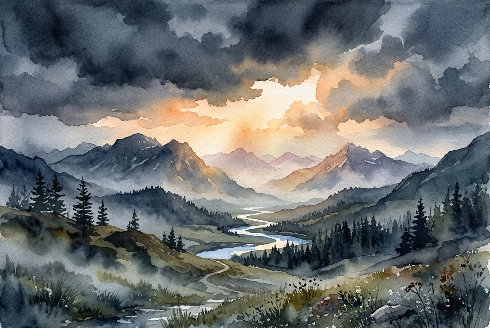

# Daily Reading: Matthew 5:1-12

*November 2, 2026*

> *(Image: A serene mountain landscape at dawn where gentle morning light breaks through heavy, dark clouds over a quiet valley.)*

## The Reading (NLT)

**Matthew 5:1-12**

> 1 One day as he saw the crowds gathering, Jesus went up on the mountainside and sat down. His disciples gathered around him, 2 and he began to teach them. 3 God blesses those who are poor and realize their need for him, for the Kingdom of Heaven is theirs. 4 God blesses those who mourn, for they will be comforted. 5 God blesses those who are humble, for they will inherit the whole earth. 6 God blesses those who hunger and thirst for justice, for they will be satisfied. 7 God blesses those who are merciful, for they will be shown mercy. 8 God blesses those whose hearts are pure, for they will see God. 9 God blesses those who work for peace, for they will be called the children of God. 10 God blesses those who are persecuted for doing right, for the Kingdom of Heaven is theirs. 11 God blesses you when people mock you and persecute you and lie about you and say all sorts of evil things against you because you are my followers. 12 Be happy about it! Be very glad! For a great reward awaits you in heaven. And remember, the ancient prophets were persecuted in the same way.

## The Story

The setting is a hillside where a rabbi sits down to deliver his inaugural vision for a new way of living. His audience is not made up of the powerful, wealthy, or comfortable elite of society. Instead, he speaks to regular people intimately familiar with Roman occupation, poverty, and grief. In this teaching, he completely flips the cultural script of the ancient world. Rather than praising military might or political dominance, he assigns ultimate value to the marginalized and the gentle. He declares that the very people the world pities are the ones who actually hold the keys to a divine reality.

## Application for Today

We often measure a good life by our level of comfort, success, and social standing. When we face grief, scarcity, or opposition, it is easy to feel as though we have been abandoned or have somehow failed. Yet this hillside teaching invites us to look at our hardships through a completely different lens. The moments when we feel most depleted, heartbroken, or pushed aside are precisely where grace meets us. True stability is not found in avoiding pain, but in discovering that divine comfort and justice are promised to those who endure it. We are called to embody this quiet resilience, trusting that mercy and peace hold more lasting power than any temporary achievement.

---

*Scripture quotations are taken from the Holy Bible, New Living Translation, copyright © 1996, 2004, 2015 by Tyndale House Foundation. Used by permission of Tyndale House Publishers.*
