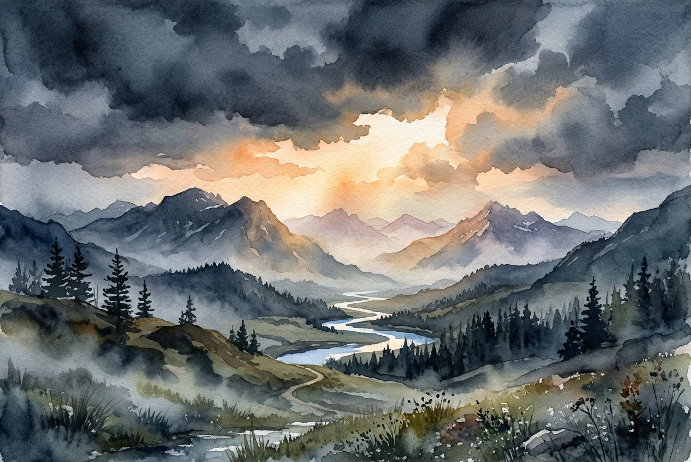

# Leitura Diária: Matthew 5:1-12

*2 de novembro de 2026*

> *(Image: A serene mountain landscape at dawn where gentle morning light breaks through heavy, dark clouds over a quiet valley.)*

## A Leitura (PT-NVI)

**Matthew 5:1-12**

> 1 Vendo as multidões, Jesus subiu ao monte e se assentou. Seus discípulos aproximaram-se dele, 2 e ele começou a ensiná-los, dizendo: 3 "Bem-aventurados os pobres em espírito, pois deles é o Reino dos céus. 4 Bem-aventurados os que choram, pois serão consolados. 5 Bem-aventurados os humildes, pois eles receberão a terra por herança. 6 Bem-aventurados os que têm fome e sede de justiça, pois serão satisfeitos. 7 Bem-aventurados os misericordiosos, pois obterão misericórdia. 8 Bem-aventurados os puros de coração, pois verão a Deus. 9 Bem-aventurados os pacificadores, pois serão chamados filhos de Deus. 10 Bem-aventurados os perseguidos por causa da justiça, pois deles é o Reino dos céus. 11 "Bem-aventurados serão vocês quando, por minha causa os insultarem, perseguirem e levantarem todo tipo de calúnia contra vocês. 12 Alegrem-se e regozijem-se, porque grande é a recompensa de vocês nos céus, pois da mesma forma perseguiram os profetas que viveram antes de vocês".

## A História

O cenário é a encosta de uma montanha onde um mestre se assenta para apresentar sua visão inaugural de um novo modo de viver. Seu público não é formado pela elite poderosa, rica ou confortável da sociedade da época. Em vez disso, ele fala a pessoas comuns, intimamente familiarizadas com a ocupação romana, a pobreza e a dor. Neste ensino, ele inverte completamente a lógica cultural do mundo antigo. Em vez de exaltar a força militar ou o domínio político, ele atribui valor supremo aos marginalizados e aos mansos. Ele declara que as mesmas pessoas das quais o mundo tem pena são aquelas que, na verdade, possuem as chaves de uma realidade divina.

## Aplicação para Hoje

Muitas vezes medimos uma vida boa pelo nosso nível de conforto, sucesso e posição social. Quando enfrentamos luto, escassez ou oposição, é fácil sentir que fomos abandonados ou que de alguma forma falhamos. No entanto, este ensino na montanha nos convida a olhar para as nossas dificuldades através de uma lente completamente diferente. Os momentos em que nos sentimos mais esgotados, com o coração partido ou deixados de lado são precisamente onde a graça nos encontra. A verdadeira estabilidade não se encontra em evitar a dor, mas em descobrir que o consolo e a justiça divinos são prometidos àqueles que a suportam. Somos chamados a encarnar essa resiliência silenciosa, confiando que a misericórdia e a paz têm um poder mais duradouro do que qualquer conquista passageira.

---

*Citações bíblicas extraídas da Nova Versão Internacional (NVI), © 1993, 2000 por Biblica, Inc. Usado com permissão.*
