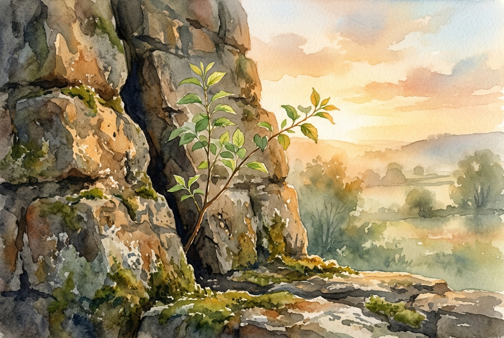

# Daily Reading: Romans 5:1-11

*November 3, 2026*

> *(Image: A resilient sapling growing from a deep crack in a weathered stone wall, bathed in the warm, golden light of dawn.)*

## The Reading (NLT)

**Romans 5:1-11**

> 1 Therefore, since we have been made right in God's sight by faith, we have peace with God because of what Jesus Christ our Lord has done for us. 2 Because of our faith, Christ has brought us into this place of undeserved privilege where we now stand, and we confidently and joyfully look forward to sharing God's glory. 3 We can rejoice, too, when we run into problems and trials, for we know that they help us develop endurance. 4 And endurance develops strength of character, and character strengthens our confident hope of salvation. 5 And this hope will not lead to disappointment. For we know how dearly God loves us, because he has given us the Holy Spirit to fill our hearts with his love. 6 When we were utterly helpless, Christ came at just the right time and died for us sinners. 7 Now, most people would not be willing to die for an upright person, though someone might perhaps be willing to die for a person who is especially good. 8 But God showed his great love for us by sending Christ to die for us while we were still sinners. 9 And since we have been made right in God's sight by the blood of Christ, he will certainly save us from God's condemnation. 10 For since our friendship with God was restored by the death of his Son while we were still his enemies, we will certainly be saved through the life of his Son. 11 So now we can rejoice in our wonderful new relationship with God because our Lord Jesus Christ has made us friends of God.

## The Story

Paul writes to a Roman church deeply divided by cultural and religious differences, trying to figure out who truly belongs. He dismantles their status games by pointing to a completely different foundation for their standing before the Divine. He traces a remarkable progression where suffering is no longer a sign of divine disfavor, but a forge for endurance and character. This chain reaction culminates in a resilient expectation of good that cannot be shattered by circumstance. The ultimate proof of this security is historical and deeply personal: the sacrifice made for them not when they were pristine, but when they were entirely alienated.

## Application for Today

It is easy to believe we must earn our peace, polishing our lives until we are worthy of rescue. Yet this passage insists that love arrived precisely when we had nothing to offer. The hardships we face are not punishments, but the very soil where a durable, unshakable confidence grows. When we stop trying to prove our worth, we can finally rest in the reality that we are already reconciled. This shifts our perspective on difficult days, allowing us to see them as spaces where our spiritual resilience is being quietly built. We can face tomorrow not with anxious striving, but with the quiet assurance of those who are deeply and securely loved.

---

*Scripture quotations are taken from the Holy Bible, New Living Translation, copyright © 1996, 2004, 2015 by Tyndale House Foundation. Used by permission of Tyndale House Publishers.*
