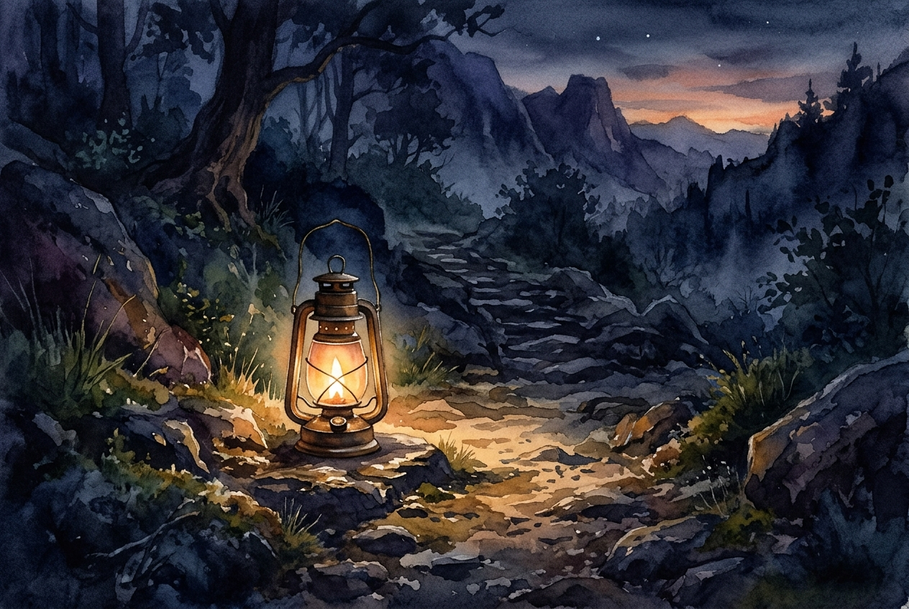

# Daily Reading: John 3:16-21

*November 4, 2026*

> *(Image: A single lantern glowing warmly on a dark, rocky path, illuminating a safe passage forward through the shadows.)*

## The Reading (NLT)

**John 3:16-21**

> 16 For this is how God loved the world: He gave his one and only Son, so that everyone who believes in him will not perish but have eternal life. 17 God sent his Son into the world not to judge the world, but to save the world through him. 18 There is no judgment against anyone who believes in him. But anyone who does not believe in him has already been judged for not believing in God's one and only Son. 19 And the judgment is based on this fact: God's light came into the world, but people loved the darkness more than the light, for their actions were evil. 20 All who do evil hate the light and refuse to go near it for fear their sins will be exposed. 21 But those who do what is right come to the light so others can see that they are doing what God wants.

## The Story

The author of this Gospel frames the arrival of the divine not as a courtroom trial, but as a rescue mission born out of profound love. In the ancient world, deities were often viewed as capricious or demanding, requiring constant appeasement. Here, the narrative flips that expectation entirely, presenting a Creator who takes the initiative to save rather than condemn. The imagery shifts to a stark contrast between light and darkness, representing truth and concealment. People often retreat into the shadows to hide their flaws, fearing exposure and judgment. Yet, the text suggests that the light is meant to heal rather than to shame.

## Application for Today

It is human nature to want to hide our mistakes and vulnerabilities. We often carry a quiet fear that if all our actions were brought into the open, we would be met with rejection. But the invitation here is to step out of the shadows and trust the motives of the one who sent the light. The purpose of this illumination is salvation, offering a safe place to be fully known and still fully loved. When we choose to live honestly, we realize the light does not just expose our fractures, but highlights the restorative work happening within us. We are invited to drop our defenses and allow ourselves to be rescued.

---

*Scripture quotations are taken from the Holy Bible, New Living Translation, copyright © 1996, 2004, 2015 by Tyndale House Foundation. Used by permission of Tyndale House Publishers.*
