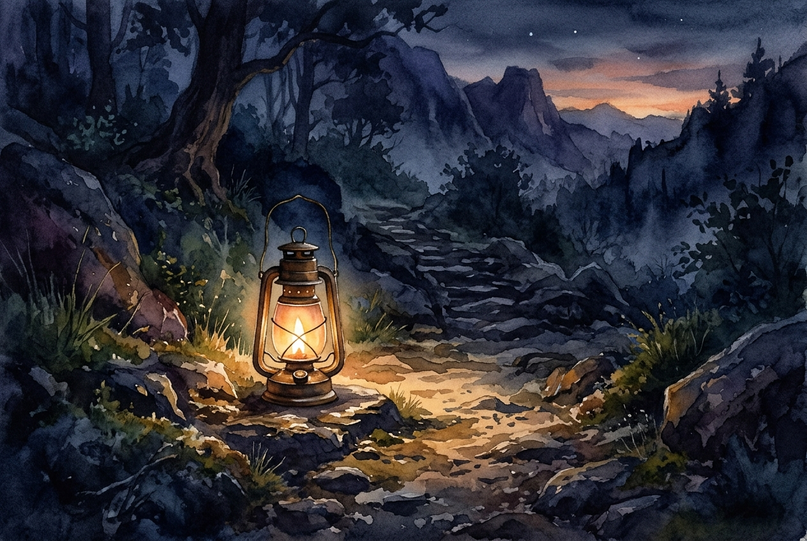

# Leitura Diária: John 3:16-21

*4 de novembro de 2026*

> *(Image: A single lantern glowing warmly on a dark, rocky path, illuminating a safe passage forward through the shadows.)*

## A Leitura (PT-NVI)

**John 3:16-21**

> 16 "Porque Deus tanto amou o mundo que deu o seu Filho Unigênito, para que todo o que nele crer não pereça, mas tenha a vida eterna. 17 Pois Deus enviou o seu Filho ao mundo, não para condenar o mundo, mas para que este fosse salvo por meio dele. 18 Quem nele crê não é condenado, mas quem não crê já está condenado, por não crer no nome do Filho Unigênito de Deus. 19 Este é o julgamento: a luz veio ao mundo, mas os homens amaram as trevas, e não a luz, porque as suas obras eram más. 20 Quem pratica o mal odeia a luz e não se aproxima da luz, temendo que as suas obras sejam manifestas. 21 Mas quem pratica a verdade vem para a luz, para que se veja claramente que as suas obras são realizadas por intermédio de Deus".

## A História

O autor deste Evangelho apresenta a chegada do divino não como um tribunal, mas como uma missão de resgate nascida de um amor profundo. No mundo antigo, as divindades frequentemente eram vistas como caprichosas ou exigentes, precisando de apaziguamento constante. Aqui, a narrativa inverte totalmente essa expectativa, mostrando um Criador que toma a iniciativa de salvar em vez de condenar. A linguagem muda para um forte contraste entre luz e escuridão, representando a verdade e a ocultação. As pessoas muitas vezes recuam para as sombras para esconder suas falhas, temendo a exposição e o julgamento. No entanto, o texto sugere que a luz tem o propósito de curar e não de envergonhar.

## Aplicação para Hoje

É da natureza humana querer esconder nossos erros e vulnerabilidades. Muitas vezes carregamos o medo silencioso de que, se todas as nossas ações fossem trazidas a público, enfrentaríamos a rejeição. Mas o convite aqui é para sair das sombras e confiar nas intenções daquele que enviou a luz. O propósito dessa iluminação é a salvação, oferecendo um lugar seguro para sermos totalmente conhecidos e, ainda assim, profundamente amados. Quando escolhemos viver com honestidade, percebemos que a luz não apenas expõe nossas fraturas, mas destaca o trabalho restaurador que está acontecendo dentro de nós. Somos convidados a baixar nossas defesas e permitir que sejamos resgatados.

---

*Citações bíblicas extraídas da Nova Versão Internacional (NVI), © 1993, 2000 por Biblica, Inc. Usado com permissão.*
