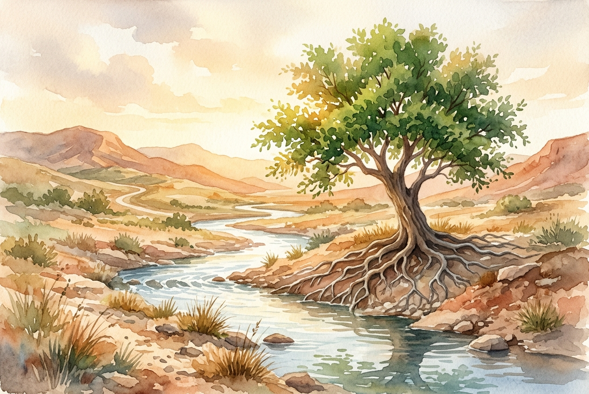

# Daily Reading: Psalm 1

*November 4, 2026*

> *(Image: A solitary flourishing tree with deep visible roots growing alongside a gently flowing stream in a sunlit arid landscape.)*

## The Reading (NLT)

**Psalm 1**

> 1 Oh, the joys of those who do not follow the advice of the wicked, or stand around with sinners, or join in with mockers. 2 But they delight in the law of the Lord, meditating on it day and night. 3 They are like trees planted along the riverbank, bearing fruit each season. Their leaves never wither, and they prosper in all they do. 4 But not the wicked! They are like worthless chaff, scattered by the wind. 5 They will be condemned at the time of judgment. Sinners will have no place among the godly. 6 For the Lord watches over the path of the godly, but the path of the wicked leads to destruction.

## The Story

The opening of the Psalter serves as a prologue for all the songs and prayers that follow, presenting a stark contrast between two ways of living. In the arid landscape of the ancient Near East, a tree situated by a constant water source was a striking symbol of endurance and vitality. The writer contrasts this deep-rooted life with chaff, the weightless husks of grain that farmers would toss into the wind to be blown away. This imagery moves beyond simple moral instruction to illustrate the very mechanics of spiritual survival. It asks the reader to consider where they draw their deepest nourishment.

## Application for Today

Every day presents a choice about where we plant ourselves and what voices we allow to shape our inner lives. It is incredibly easy to get caught up in the cynical currents of our culture, becoming untethered and drifting along with whatever wind is blowing. Yet, we are invited to sink our roots into a deeper, more enduring source of wisdom. This groundedness does not prevent the harsh seasons of life from coming, but it ensures we have the hidden sustenance required to endure them. By drawing quietly from this steady stream, we find the resilience to grow and offer something beautiful to the world right when it is most needed.

---

*Scripture quotations are taken from the Holy Bible, New Living Translation, copyright © 1996, 2004, 2015 by Tyndale House Foundation. Used by permission of Tyndale House Publishers.*
