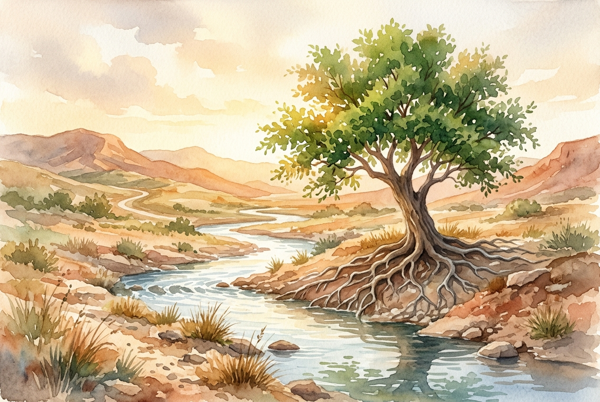

# Leitura Diária: Psalm 1

*4 de novembro de 2026*

> *(Image: A solitary flourishing tree with deep visible roots growing alongside a gently flowing stream in a sunlit arid landscape.)*

## A Leitura (PT-NVI)

**Psalm 1**

> 1 Como é feliz aquele que não segue o conselho dos ímpios, não imita a conduta dos pecadores, nem se assenta na roda dos zombadores! 2 Ao contrário, sua satisfação está na lei do Senhor, e nessa lei medita dia e noite. 3 É como árvore plantada à beira de águas correntes: Dá fruto no tempo certo e suas folhas não murcham. Tudo o que ele faz prospera! 4 Não é o caso dos ímpios! São como palha que o vento leva. 5 Por isso os ímpios não resistirão no julgamento, nem os pecadores na comunidade dos justos. 6 Pois o Senhor aprova o caminho dos justos, mas o caminho dos ímpios leva à destruição!

## A História

A abertura do livro de Salmos serve como um prólogo para todas as canções e orações que se seguem, apresentando um contraste claro entre duas formas de viver. Na paisagem árida do antigo Oriente Médio, uma árvore situada junto a uma fonte constante de água era um símbolo impressionante de resistência e vitalidade. O autor contrasta essa vida de raízes profundas com a palha, as cascas leves dos grãos que os agricultores jogavam ao vento para serem levadas. Essa imagem vai além de uma simples instrução moral para ilustrar a própria mecânica da sobrevivência espiritual. O texto convida o leitor a refletir sobre onde busca sua nutrição mais profunda.

## Aplicação para Hoje

Todos os dias enfrentamos a escolha de onde nos plantar e quais vozes permitimos que moldem nosso interior. É extremamente fácil ser levado pelas correntes cínicas da nossa cultura, perdendo as amarras e vagando com qualquer vento que sopre. No entanto, somos convidados a aprofundar nossas raízes em uma fonte de sabedoria mais duradoura e verdadeira. Essa firmeza não impede que as estações difíceis cheguem, mas garante o sustento oculto necessário para suportá-las. Ao bebermos silenciosamente dessa correnteza constante, encontramos a resiliência para crescer e oferecer algo belo ao mundo exatamente quando é mais necessário.

---

*Citações bíblicas extraídas da Nova Versão Internacional (NVI), © 1993, 2000 por Biblica, Inc. Usado com permissão.*
