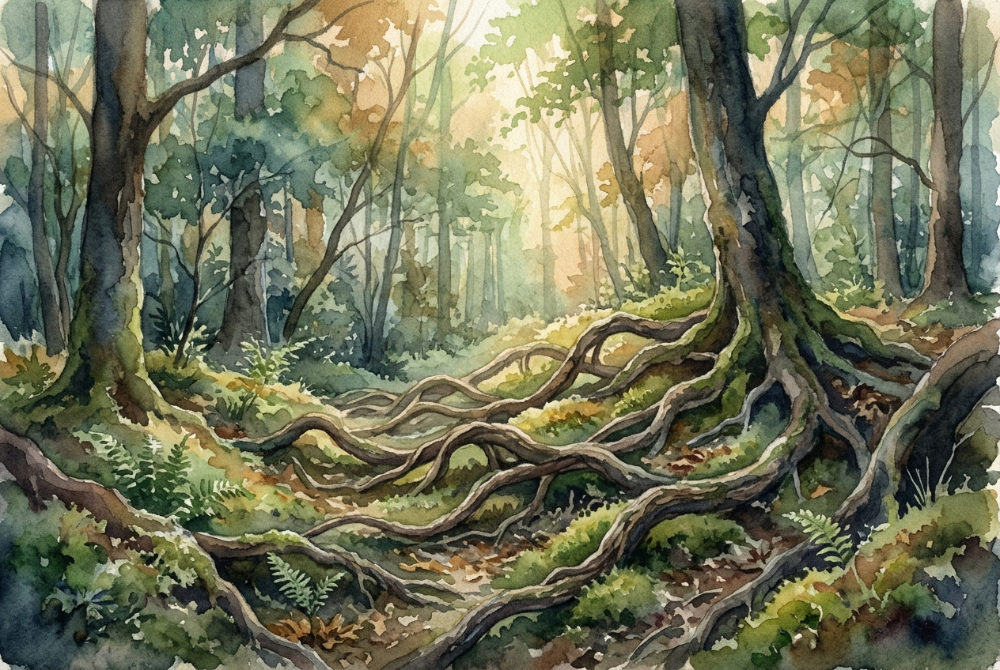

# Daily Reading: 1 John 4:7-16

*November 5, 2026*

> *(Image: A gentle morning light filtering through a dense forest canopy, illuminating an intricate network of intertwined tree roots on the mossy ground.)*

## The Reading (NLT)

**1 John 4:7-16**

> 7 Dear friends, let us continue to love one another, for love comes from God. Anyone who loves is a child of God and knows God. 8 But anyone who does not love does not know God, for God is love. 9 God showed how much he loved us by sending his one and only Son into the world so that we might have eternal life through him. 10 This is real love not that we loved God, but that he loved us and sent his Son as a sacrifice to take away our sins. 11 Dear friends, since God loved us that much, we surely ought to love each other. 12 No one has ever seen God. But if we love each other, God lives in us, and his love is brought to full expression in us. 13 And God has given us his Spirit as proof that we live in him and he in us. 14 Furthermore, we have seen with our own eyes and now testify that the Father sent his Son to be the Savior of the world. 15 All who declare that Jesus is the Son of God have God living in them, and they live in God. 16 We know how much God loves us, and we have put our trust in his love. God is love, and all who live in love live in God, and God lives in them.

## The Story

The early Christian communities were wrestling with deep divisions and questions about how to truly know the divine. In this letter, the author strips away complicated theological arguments to present a radical, foundational truth about the nature of the Creator. The text insists that the divine essence is not distant power or strict judgment, but active, self-giving affection. This affection was not a theoretical concept, but a historical reality demonstrated through the arrival of the Son. The writer makes a striking claim that human attempts to reach upward are secondary to the reality that the divine first reached downward. Knowing the Creator, therefore, is entirely inseparable from the experience of this profound affection.

## Application for Today

We often look for spectacular signs or complex spiritual formulas to confirm that we are on the right path. Yet this passage grounds our spiritual life in the everyday practice of caring for one another. Since the Creator is invisible to our physical eyes, the way the divine presence becomes tangible in the world is through our mutual care. When we choose patience, generosity, and compassion toward the people around us, we are doing much more than being kind. We are actually allowing the divine presence to take up residence in our ordinary lives and become visible to those around us. Our human relationships become the very vessels where eternal affection is brought to its fullest expression.

---

*Scripture quotations are taken from the Holy Bible, New Living Translation, copyright © 1996, 2004, 2015 by Tyndale House Foundation. Used by permission of Tyndale House Publishers.*
