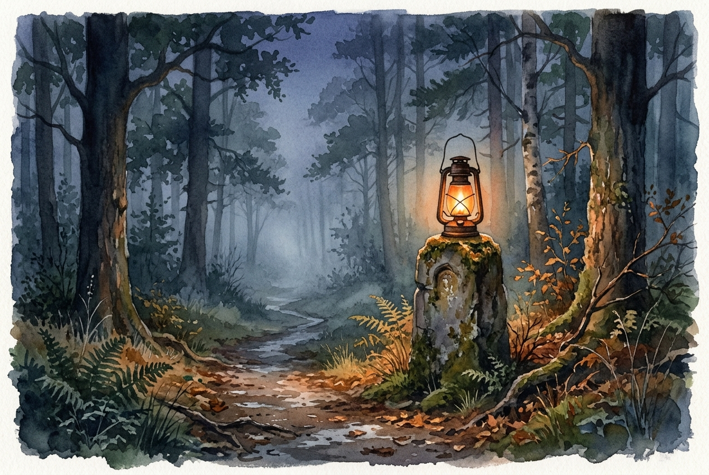

# Leitura Diária: John 14:1-7

*5 de novembro de 2026*

> *(Image: A quiet, mist-covered forest path at twilight, gently illuminated by a warm, glowing lantern resting on an ancient stone marker.)*

## A Leitura (PT-NVI)

**John 14:1-7**

> 1 "Não se perturbe o coração de vocês. Creiam em Deus; creiam também em mim. 2 Na casa de meu Pai há muitos aposentos; se não fosse assim, eu lhes teria dito. Vou preparar-lhes lugar. 3 E se eu for e lhes preparar lugar, voltarei e os levarei para mim, para que vocês estejam onde eu estiver. 4 Vocês conhecem o caminho para onde vou". 5 Disse-lhe Tomé: "Senhor, não sabemos para onde vais; como então podemos saber o caminho? " 6 Respondeu Jesus: "Eu sou o caminho, a verdade e a vida. Ninguém vem ao Pai, a não ser por mim. 7 Se vocês realmente me conhecessem, conheceriam também o meu Pai. Já agora vocês o conhecem e o têm visto".

## A História

O contexto desta conversa é uma última refeição entre amigos, marcada por profunda tensão e despedidas iminentes. Os discípulos estão lidando com o colapso de suas expectativas, ouvindo seu mestre falar sobre traição e partida. Naquela sala tomada pela ansiedade, eles desejam um plano concreto ou um destino geográfico que possa acalmar seus medos. Tomé expressa o pânico coletivo, pedindo instruções claras sobre como chegar a esse lugar desconhecido. Em vez de fornecer um mapa ou um conjunto de coordenadas, a resposta que recebem foca inteiramente no relacionamento. O destino e a rota estão intrinsecamente ligados à pessoa que está bem ali, diante deles.

## Aplicação para Hoje

Quando nossas próprias vidas parecem incertas, frequentemente procuramos um roteiro detalhado para garantir que estamos na direção certa. Queremos instruções passo a passo para lidar com o luto, com transições difíceis ou com a dúvida espiritual. No entanto, este texto sugere que navegar pelo desconhecido tem menos a ver com ter todas as respostas e mais com confiar em quem caminha ao nosso lado. A resposta divina para a ansiedade humana não é um itinerário exato, mas um convite para observar de perto o exemplo de Cristo. Ao notarmos como ele se movia pelo mundo com compaixão e verdade, descobrimos a trilha que devemos seguir. O caminho adiante não é um lugar, mas uma presença constante.

---

*Citações bíblicas extraídas da Nova Versão Internacional (NVI), © 1993, 2000 por Biblica, Inc. Usado com permissão.*
