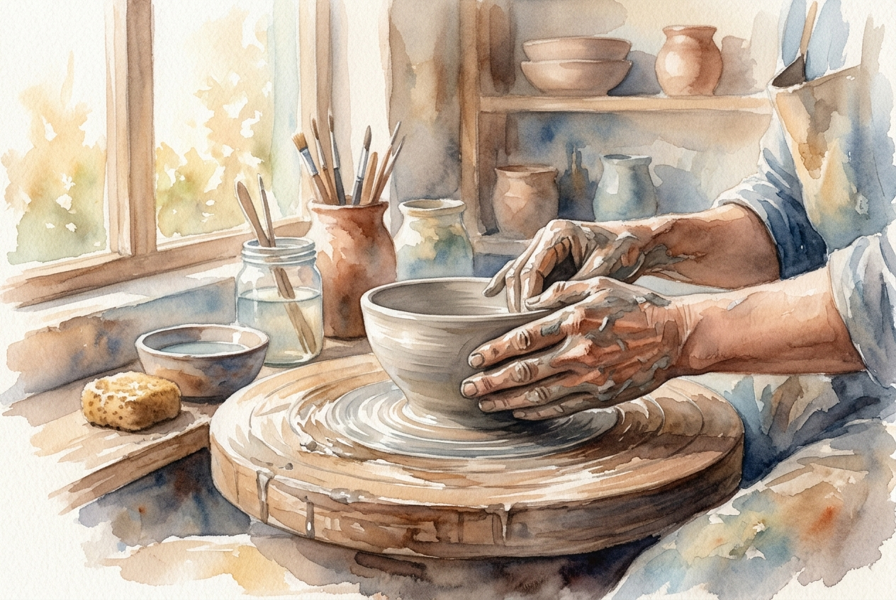

# Daily Reading: Romans 12:1-2

*November 7, 2026*

> *(Image: A potter's hands gently shaping a piece of clay on a wooden wheel, illuminated by soft morning light.)*

## The Reading (NLT)

**Romans 12:1-2**

> 1 And so, dear brothers and sisters, I plead with you to give your bodies to God because of all he has done for you. Let them be a living and holy sacrifice the kind he will find acceptable. This is truly the way to worship him. 2 Don't copy the behavior and customs of this world, but let God transform you into a new person by changing the way you think. Then you will learn to know God's will for you, which is good and pleasing and perfect.

## The Story

Paul was writing to a community living in the very center of the Roman Empire, a culture obsessed with status, power, and assimilation. The expectation was that everyone would fall in line with the imperial way of life, adopting its values and its definition of success. Against this backdrop, the call to resist the world's pattern was a radical challenge. Instead of offering dead animals on an altar as was customary in both Roman and Jewish traditions, these early believers were asked to offer their everyday, waking lives. They were invited to let their minds be entirely rewired by a different kind of logic.

## Application for Today

We still live in a world that constantly pressures us to fit into its mold, pushing us toward endless consumption, outrage, and self-promotion. It is exhausting to keep up with a culture that values us only for what we produce or how we appear. But the invitation here is to step off that treadmill and allow our inner lives to be reshaped by grace. When we stop trying to mimic the frantic rhythms around us, we create space for a deeper transformation. Day by day, our thoughts and habits can shift, revealing a path that is remarkably good, life-giving, and completely whole.

---

*Scripture quotations are taken from the Holy Bible, New Living Translation, copyright © 1996, 2004, 2015 by Tyndale House Foundation. Used by permission of Tyndale House Publishers.*
