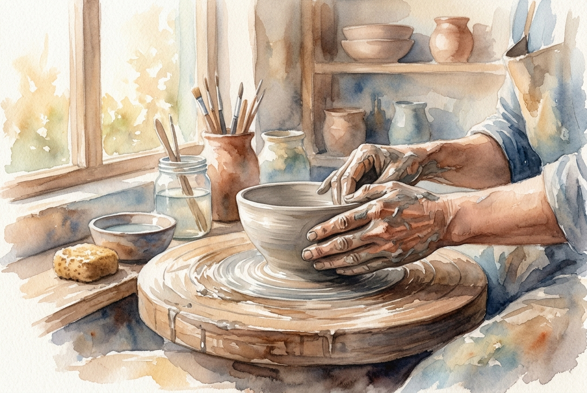

# Leitura Diária: Romans 12:1-2

*7 de novembro de 2026*

> *(Image: A potter's hands gently shaping a piece of clay on a wooden wheel, illuminated by soft morning light.)*

## A Leitura (PT-NVI)

**Romans 12:1-2**

> 1 Portanto, irmãos, rogo-lhes pelas misericórdias de Deus que se ofereçam em sacrifício vivo, santo e agradável a Deus; este é o culto racional de vocês. 2 Não se amoldem ao padrão deste mundo, mas transformem-se pela renovação da sua mente, para que sejam capazes de experimentar e comprovar a boa, agradável e perfeita vontade de Deus.

## A História

Paulo escrevia para uma comunidade que vivia no centro do Império Romano, uma cultura obcecada por status, poder e assimilação. A expectativa era que todos se alinhassem ao modo de vida imperial, adotando seus valores e sua definição de sucesso. Nesse cenário, o chamado para resistir ao padrão dominante era um desafio radical. Em vez de oferecer animais em um altar, como era o costume nas tradições romana e judaica, esses primeiros cristãos foram chamados a oferecer sua vida cotidiana. Eles foram convidados a deixar que suas mentes fossem inteiramente reconfiguradas por uma lógica diferente.

## Aplicação para Hoje

Ainda vivemos em um mundo que nos pressiona constantemente a nos encaixarmos em seu molde, empurrando-nos para o consumo sem fim, a indignação e a autopromoção. É exaustivo tentar acompanhar uma cultura que nos valoriza apenas pelo que produzimos ou pela nossa aparência. Mas o convite aqui é para descer dessa esteira e permitir que nossa vida interior seja remodelada pela graça. Quando paramos de tentar imitar os ritmos frenéticos ao nosso redor, criamos espaço para uma transformação mais profunda. Dia após dia, nossos pensamentos e hábitos podem mudar, revelando um caminho que é extraordinariamente bom, vivificante e completo.

---

*Citações bíblicas extraídas da Nova Versão Internacional (NVI), © 1993, 2000 por Biblica, Inc. Usado com permissão.*
