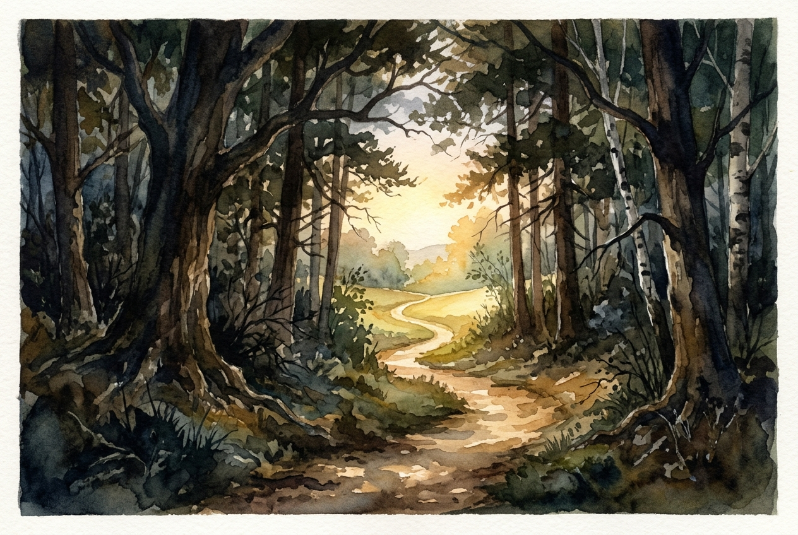

# Daily Reading: Romans 5:1-11

*November 8, 2026*

> *(Image: A serene sunlit path winding through a dense shadowy forest, symbolizing hope and endurance emerging from trials.)*

## The Reading (NLT)

**Romans 5:1-11**

> 1 Therefore, since we have been made right in God's sight by faith, we have peace with God because of what Jesus Christ our Lord has done for us. 2 Because of our faith, Christ has brought us into this place of undeserved privilege where we now stand, and we confidently and joyfully look forward to sharing God's glory. 3 We can rejoice, too, when we run into problems and trials, for we know that they help us develop endurance. 4 And endurance develops strength of character, and character strengthens our confident hope of salvation. 5 And this hope will not lead to disappointment. For we know how dearly God loves us, because he has given us the Holy Spirit to fill our hearts with his love. 6 When we were utterly helpless, Christ came at just the right time and died for us sinners. 7 Now, most people would not be willing to die for an upright person, though someone might perhaps be willing to die for a person who is especially good. 8 But God showed his great love for us by sending Christ to die for us while we were still sinners. 9 And since we have been made right in God's sight by the blood of Christ, he will certainly save us from God's condemnation. 10 For since our friendship with God was restored by the death of his Son while we were still his enemies, we will certainly be saved through the life of his Son. 11 So now we can rejoice in our wonderful new relationship with God because our Lord Jesus Christ has made us friends of God.

## The Story

The apostle Paul wrote to a community in Rome that was intimately familiar with hardship and social tension. In this letter, he bridges a profound gap, moving from the legal language of justice to the intimate language of friendship with the divine. He explains that this newfound relationship is not a fragile truce but a permanent standing in grace. Paul introduces a radical progression where suffering is no longer a sign of divine abandonment but a crucible for spiritual maturity. The early Christians were taught to see their struggles as the very soil where resilience grows, eventually blossoming into an unshakeable confidence in divine love.

## Application for Today

It is deeply countercultural to look at our difficulties and see the raw materials of hope. Yet, this passage invites us to reframe our trials not as punishments, but as the beginning of a transformative process. When we face obstacles, we are building a quiet endurance that shapes our character over time. This kind of character anchors us, preventing the storms of life from sweeping away our sense of belovedness. We do not have to clean ourselves up or achieve perfection to be welcomed into this peace. The divine love described here reaches out to us exactly where we are, transforming our deepest fractures into a resilient, enduring hope.

---

*Scripture quotations are taken from the Holy Bible, New Living Translation, copyright © 1996, 2004, 2015 by Tyndale House Foundation. Used by permission of Tyndale House Publishers.*
