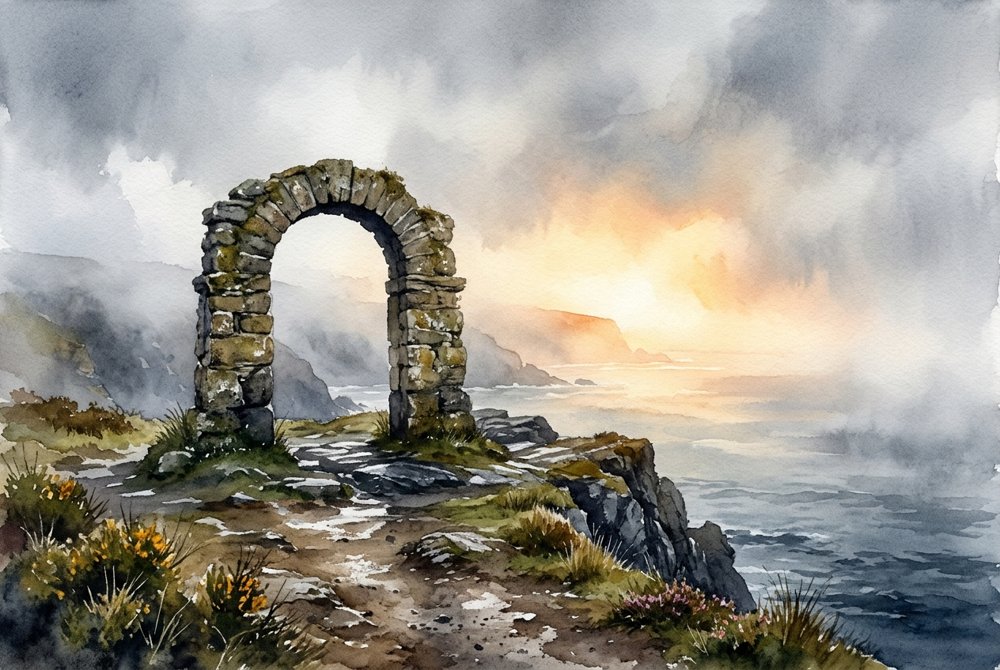

# Daily Reading: 2 Corinthians 4:16-18

*November 8, 2026*

> *(Image: A weathered stone archway standing firm on a misty coastal cliff, with a bright and warm light breaking through the heavy fog in the distance.)*

## The Reading (NLT)

**2 Corinthians 4:16-18**

> 16 That is why we never give up. Though our bodies are dying, our spirits are being renewed every day. 17 For our present troubles are small and won't last very long. Yet they produce for us a glory that vastly outweighs them and will last forever! 18 So we don't look at the troubles we can see now; rather, we fix our gaze on things that cannot be seen. For the things we see now will soon be gone, but the things we cannot see will last forever.

## The Story

Paul was writing to a Corinthian church that was intimately familiar with his physical and emotional scars. He had faced imprisonment, beatings, and shipwrecks, making his resolve deeply personal and hard-earned. In the ancient world, physical suffering was often viewed as a sign of divine disfavor or a mark of failure. Paul flips this assumption entirely, suggesting that outward deterioration is merely the backdrop for a profound and invisible transformation. He introduces a radical contrast between the visible struggles of the present and an enduring reality. By weighing his intense hardships against a coming glory, he invites his readers to adopt an entirely different scale of measurement.

## Application for Today

It is incredibly easy to be overwhelmed by what is right in front of us. Pain, exhaustion, and daily frustrations demand our immediate attention and often dictate our mood. Yet, we are invited to cultivate a vision that looks past the immediate surface of our circumstances. This does not mean pretending our struggles do not hurt, but rather trusting that they are not the final word. There is a quiet, steady renewal happening within us, even when we feel like we are falling apart on the outside. By shifting our focus to what is lasting and eternal, we find the strength to keep moving forward. We learn to anchor our hope in a reality that outlasts our current pain.

---

*Scripture quotations are taken from the Holy Bible, New Living Translation, copyright © 1996, 2004, 2015 by Tyndale House Foundation. Used by permission of Tyndale House Publishers.*
