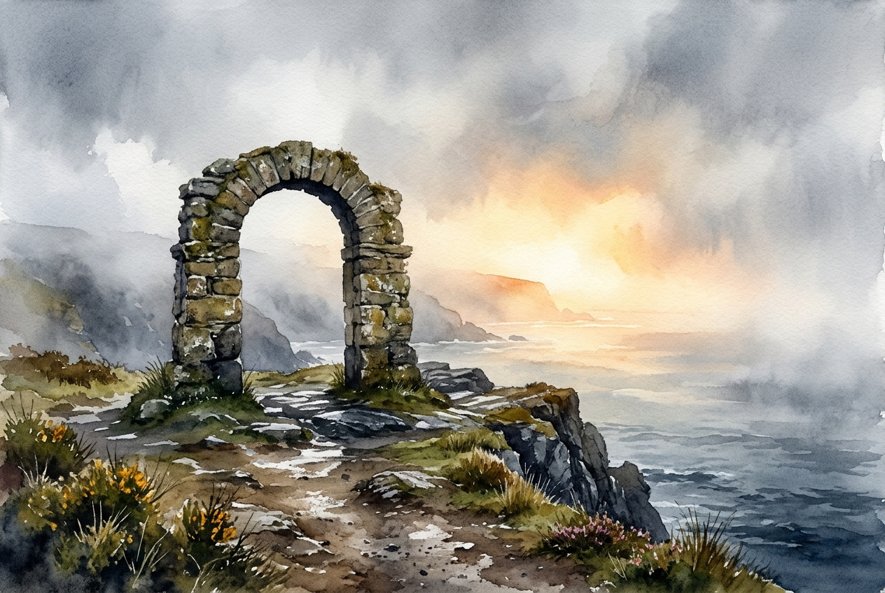

# Leitura Diária: 2 Corinthians 4:16-18

*8 de novembro de 2026*

> *(Image: A weathered stone archway standing firm on a misty coastal cliff, with a bright and warm light breaking through the heavy fog in the distance.)*

## A Leitura (PT-NVI)

**2 Corinthians 4:16-18**

> 16 Por isso não desanimamos. Embora exteriormente estejamos a desgastar-nos, interiormente estamos sendo renovados dia após dia, 17 pois os nossos sofrimentos leves e momentâneos estão produzindo para nós uma glória eterna que pesa mais do que todos eles. 18 Assim, fixamos os olhos, não naquilo que se vê, mas no que não se vê, pois o que se vê é transitório, mas o que não se vê é eterno.

## A História

Paulo escrevia para uma comunidade em Corinto que conhecia muito bem as suas cicatrizes físicas e emocionais. Ele havia enfrentado prisões, agressões e naufrágios, o que tornava sua resiliência algo profundamente pessoal e conquistado a duras penas. No mundo antigo, o sofrimento físico era frequentemente visto como um sinal de desaprovação divina ou uma marca de fracasso. Paulo inverte completamente essa lógica, sugerindo que o desgaste exterior é apenas o cenário para uma transformação profunda e invisível. Ele apresenta um contraste radical entre as lutas visíveis do presente e uma realidade duradoura. Ao pesar suas intensas dificuldades contra uma glória vindoura, ele convida seus leitores a adotarem uma escala de valores totalmente diferente.

## Aplicação para Hoje

É incrivelmente fácil nos deixarmos dominar por aquilo que está bem na nossa frente. A dor, a exaustão e as frustrações diárias exigem nossa atenção imediata e, muitas vezes, ditam nosso estado de espírito. No entanto, somos convidados a cultivar um olhar que vai além da superfície imediata das nossas circunstâncias. Isso não significa fingir que nossas lutas não doem, mas sim confiar que elas não têm a palavra final. Existe uma renovação silenciosa e constante acontecendo dentro de nós, mesmo quando sentimos que estamos desmoronando por fora. Ao mudarmos nosso foco para o que é duradouro, encontramos a força necessária para continuar caminhando. Aprendemos a ancorar nossa esperança em uma realidade que sobrevive à nossa dor atual.

---

*Citações bíblicas extraídas da Nova Versão Internacional (NVI), © 1993, 2000 por Biblica, Inc. Usado com permissão.*
