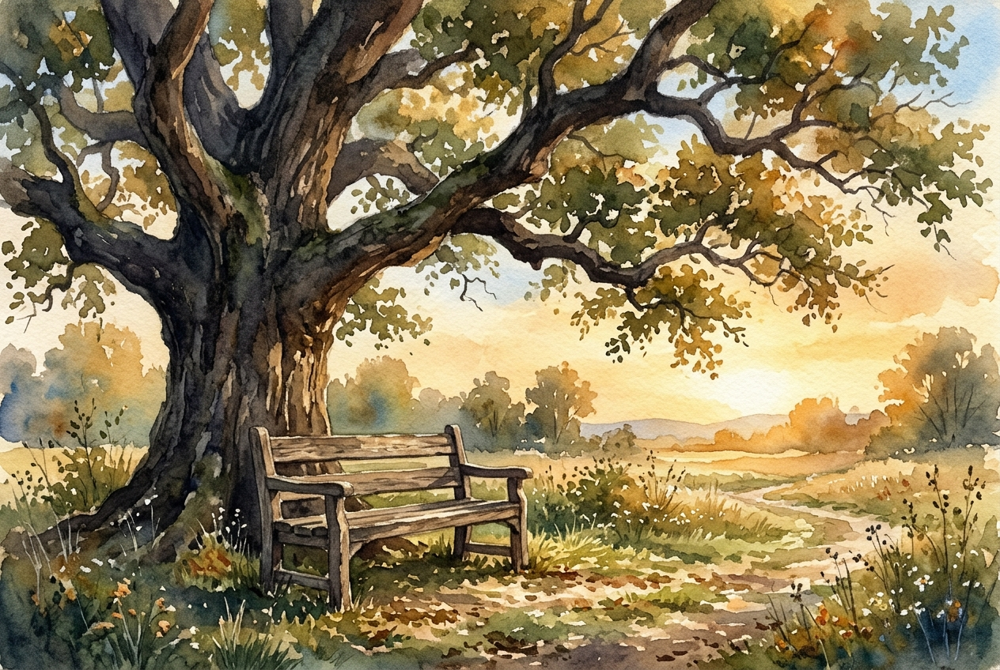

# Daily Reading: Matthew 11:28-30

*November 10, 2026*

> *(Image: A weathered wooden bench sitting quietly under the sprawling branches of a massive ancient oak tree bathed in the soft golden light of late afternoon.)*

## The Reading (NLT)

**Matthew 11:28-30**

> 28 Then Jesus said, Come to me, all of you who are weary and carry heavy burdens, and I will give you rest. 29 Take my yoke upon you. Let me teach you, because I am humble and gentle at heart, and you will find rest for your souls. 30 For my yoke is easy to bear, and the burden I give you is light.

## The Story

In the ancient world, the crowds listening to this invitation were profoundly exhausted. They carried the crushing weight of political oppression, daily survival, and a religious system that demanded endless perfection. Teachers of the law often used the metaphor of a wooden farming harness to describe submission to their rules, but in practice, it felt like an unbearable load. Christ steps into this collective fatigue with a radically different offer. He presents a way of living that does not rely on frantic striving. Instead, he invites them into a shared rhythm of grace, guided by someone whose very nature is unassuming and kind.

## Application for Today

We still carry weights that were never meant for our shoulders. Whether it is the pressure to prove our worth, the anxiety of an uncertain future, or the quiet grief we hide from the world, our inner lives easily grow tired. The invitation here is not a promise that our daily responsibilities will magically vanish. Rather, it is a shift in how we carry them. When we learn to walk alongside a teacher who leads with compassion, the cruel demands of perfectionism begin to lose their grip. We realize we are no longer pulling the load alone, and in that shared space, our deepest exhaustion finally meets true relief.

---

*Scripture quotations are taken from the Holy Bible, New Living Translation, copyright © 1996, 2004, 2015 by Tyndale House Foundation. Used by permission of Tyndale House Publishers.*
