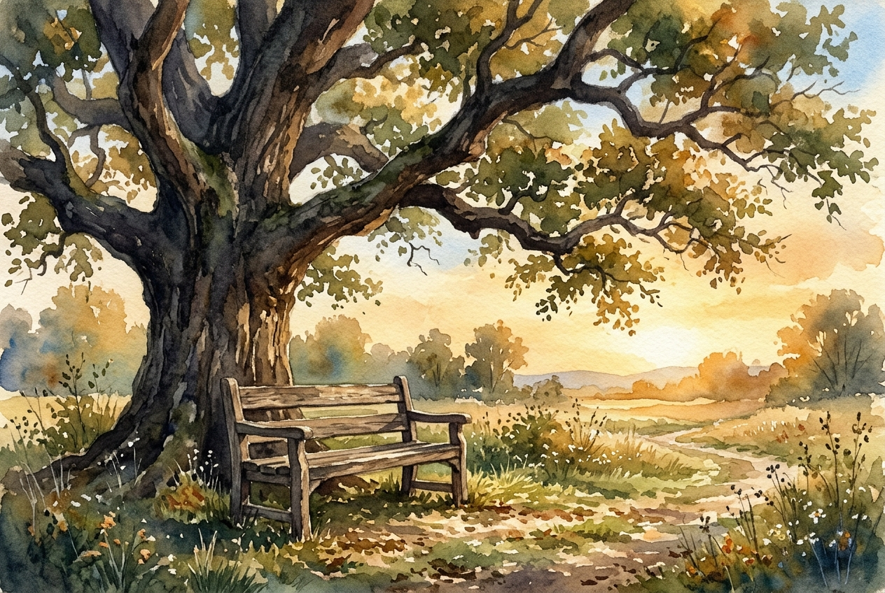

# Leitura Diária: Matthew 11:28-30

*10 de novembro de 2026*

> *(Image: A weathered wooden bench sitting quietly under the sprawling branches of a massive ancient oak tree bathed in the soft golden light of late afternoon.)*

## A Leitura (PT-NVI)

**Matthew 11:28-30**

> 28 "Venham a mim, todos os que estão cansados e sobrecarregados, e eu lhes darei descanso. 29 Tomem sobre vocês o meu jugo e aprendam de mim, pois sou manso e humilde de coração, e vocês encontrarão descanso para as suas almas. 30 Pois o meu jugo é suave e o meu fardo é leve".

## A História

No mundo antigo, as multidões que ouviam esse convite estavam profundamente exaustas. Elas carregavam o peso esmagador da opressão política, da sobrevivência diária e de um sistema religioso que exigia uma perfeição infinita. Os mestres da lei frequentemente usavam a imagem de um instrumento agrícola de madeira para descrever a submissão às suas regras, mas, na prática, isso parecia uma carga insuportável. Cristo entra nessa fadiga coletiva com uma proposta radicalmente diferente. Ele apresenta uma forma de viver que não depende de um esforço frenético. Em vez disso, ele os convida para um ritmo compartilhado de graça, guiados por alguém cuja própria natureza é acolhedora e gentil.

## Aplicação para Hoje

Ainda hoje carregamos pesos que nunca foram feitos para os nossos ombros. Seja a pressão para provar nosso valor, a ansiedade diante de um futuro incerto ou as tristezas silenciosas que escondemos do mundo, nosso interior se cansa com facilidade. O convite aqui não é uma promessa de que nossas responsabilidades diárias desaparecerão num passe de mágica. Trata-se, na verdade, de uma mudança na forma como as carregamos. Quando aprendemos a caminhar ao lado de um mestre que lidera com compaixão, as exigências cruéis do perfeccionismo perdem a força. Percebemos que não estamos mais puxando a carga sozinhos e, nesse espaço compartilhado, nossa exaustão mais profunda finalmente encontra verdadeiro alívio.

---

*Citações bíblicas extraídas da Nova Versão Internacional (NVI), © 1993, 2000 por Biblica, Inc. Usado com permissão.*
