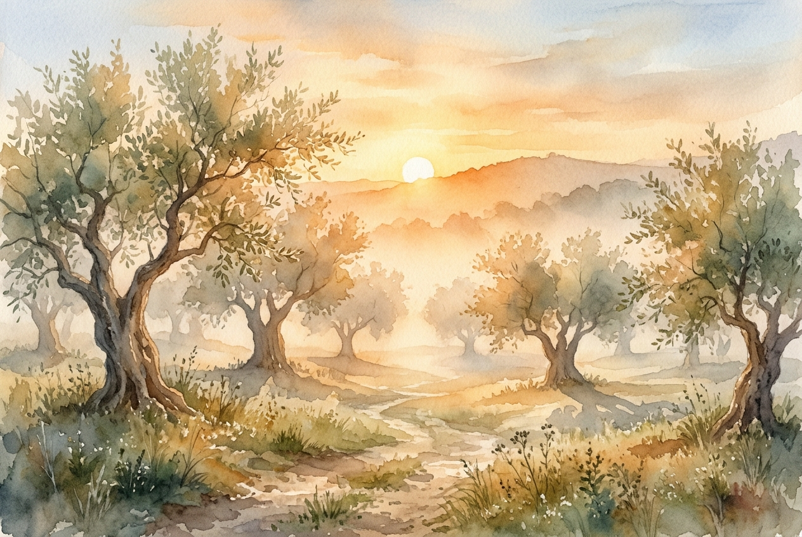

# Daily Reading: John 3:16-21

*November 10, 2026*

> *(Image: A warm, golden sunrise gently illuminating a misty, ancient olive grove, casting long soft shadows that fade into the morning light.)*

## The Reading (NLT)

**John 3:16-21**

> 16 For this is how God loved the world: He gave his one and only Son, so that everyone who believes in him will not perish but have eternal life. 17 God sent his Son into the world not to judge the world, but to save the world through him. 18 There is no judgment against anyone who believes in him. But anyone who does not believe in him has already been judged for not believing in God's one and only Son. 19 And the judgment is based on this fact: God's light came into the world, but people loved the darkness more than the light, for their actions were evil. 20 All who do evil hate the light and refuse to go near it for fear their sins will be exposed. 21 But those who do what is right come to the light so others can see that they are doing what God wants.

## The Story

In the first century, the cover of night offered a safe haven for those who were afraid to be seen. It was under this very cloak of darkness that a religious leader sought out a quiet conversation, away from the judging eyes of his peers. The culture of the time was steeped in a deep fear of divine retribution, where illness and hardship were often viewed as direct punishments from the heavens. To imagine a divine force arriving not with a gavel, but with a rescue mission, was a radical departure from the norm. The prevailing belief was that exposure meant condemnation and shame. Yet, this late-night dialogue introduced a completely different reality, painting a picture of a creator whose primary posture toward humanity is profound, self-giving love.

## Application for Today

We often carry an exhausting burden of hiding our flaws, convinced that if we are truly seen, we will be rejected. It is so easy to retreat into the shadows when we feel inadequate, fearing the harsh glare of judgment. But the divine light described here is not a police spotlight meant to interrogate or shame us. Instead, it is like the morning sun breaking through a cold night, offering warmth and a safe place to finally be ourselves. When we stop hiding and step into this light, we realize we are not met with condemnation, but with open arms. We can lay down the heavy armor of pretending and allow ourselves to be loved exactly as we are. Stepping into the light becomes an invitation to profound relief and healing.

---

*Scripture quotations are taken from the Holy Bible, New Living Translation, copyright © 1996, 2004, 2015 by Tyndale House Foundation. Used by permission of Tyndale House Publishers.*
